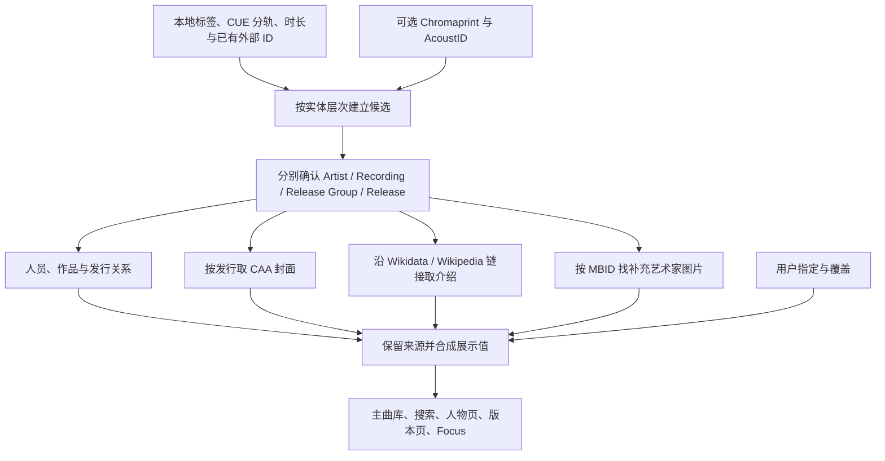

# 音乐库公开元数据来源：平台、实测与接入设计

调研日期：2026-10-22。结合 Twilight Echo 现有实现，访问官方文档并对少量公开音乐条目做只读 API 验证。本次没有修改播放器实现，也没有查询用户的实际曲库。

**推荐组合：MusicBrainz 负责音乐身份和关系，Cover Art Archive 负责发行封面，Wikidata／Wikipedia 负责跨语言身份和介绍；TheAudioDB 可补艺术家图片，Discogs 可补具体发行，AcoustID 可识别标签缺失的本地音频。**

公开数据足以支撑下一阶段的人员页、专辑版本页、作品关系和资料来源展示。资料覆盖不均、不同版本的身份匹配、来源条款和错误恢复，仍需要应用自己处理。没有一个免费接口可以同时提供完整中文目录、准确制作名单、全部图片、长篇乐评和成熟个性化推荐。

**1. 哪些平台值得接**

| 平台 | 主要能获取什么 | 最适合的角色 | 接入条件及边界 |
|---|---|---|---|
| [MusicBrainz](https://musicbrainz.org/doc/MusicBrainz_API) | 歌手／团体、别名、录音、作品、专辑组、具体发行、曲序、ISRC、条码、厂牌、人员关系、外部链接 | 主身份与关系来源 | 一般公开读取不需 key；有意义的 User-Agent；每应用不超过 1 请求／秒；公共服务非商业使用免费，商业服务另看方案 |
| [Cover Art Archive](https://musicbrainz.org/doc/Cover_Art_Archive/API) | 正封、背封、内页等图片清单及缩略图；有图才返回 | 按 MusicBrainz Release MBID 精确找封面 | 有 release 和 release-group 两种入口；图片可访问不等于继承 MusicBrainz 的 CC0 授权 |
| [Wikidata](https://www.wikidata.org/wiki/Wikidata:Data_access) | 多语言名称、别名、生卒／活动信息、人物关系、MusicBrainz／Discogs 等外部 ID、Wikipedia 条目与图片引用 | 跨平台身份连接、中文别名、结构化人物资料 | 结构化数据 CC0；优先实体 ID 查询和批量读取，避免每首歌跑全网 SPARQL |
| [Wikipedia / MediaWiki API](https://www.mediawiki.org/wiki/API:Etiquette) | 歌手简介、专辑背景、作品介绍、文章来源链接 | 面向用户的可读介绍 | 使用已确认身份关联的条目；文本保留来源和许可，通常涉及 CC BY-SA；消歧义页不直接采用 |
| [Wikimedia Commons](https://commons.wikimedia.org/wiki/Commons:API) | 歌手／团体照片及逐图作者、许可、署名元数据 | 可追溯的艺术家图片 | 每张图单独记录许可和作者；Wikidata 指向一张图不代表它也是 CC0 |
| [Discogs](https://www.discogs.com/developers/) | 艺术家、Master／Release、具体版本、国家／年份、介质、厂牌、目录号、曲目与 credits | CD、黑胶和收藏版本的补充资料 | 本次公共 artist API 可用；开发者页和条款页返回 403，未重新确认完整的现行配额和再利用条件 |
| [TheAudioDB](https://www.theaudiodb.com/free_music_api) | 歌手、专辑、歌曲基础资料，多语言介绍字段、头像、背景、Logo 等美术资料 | 艺术家页的视觉与介绍补充 | 有免费／付费层级；当前免费 key 为 123，文档列免费 30 请求／分钟；免费条款限制发布至应用商店，付费和第三方素材仍有使用条件 |
| [Last.fm](https://www.last.fm/api) | 艺术家／专辑／歌曲资料、标签、相似歌手／歌曲、榜单、收听统计；部分简介 | 发现、相似关系和社区标签 | 需要 API key；商用或研究用途需事前联系；需要署名链接；当前 artist.getInfo 文档说明简介截断至 300 字符 |
| [Apple iTunes Search](https://performance-partners.apple.com/search-api) | 歌手、专辑、歌曲名称、商店 ID、曲序、时长、发行日期、流派、商店链接和宣传素材 URL | 市场目录匹配与基础信息补充 | 无 key 的搜索／lookup；约 20 请求／分钟，可能变动；按 storefront 区分；封面／试听属于带推广使用条件的素材 |
| [AcoustID](https://acoustid.org/webservice) | 通过音频指纹查相近音频记录及 MusicBrainz recording 映射 | 标签很差、文件名不可信时辅助识别 | 应用注册取得 key；免费服务限非商业应用；最多 3 请求／秒；通常本地计算指纹，查询发送指纹与时长 |
| [ListenBrainz](https://listenbrainz.readthedocs.io/en/latest/users/api/index.html) | 收听历史、统计、录音匹配、流行度、推荐等服务 | 未来 Radio／发现功能的候选来源 | 不是主要专辑百科；不同方法的鉴权要求不同，跟随响应限流；上报用户历史应是独立的用户选择 |

这里区分了公开 API、开放数据和免费服务。三者的范围不同：例如 MusicBrainz 核心数据可自由再利用，但其公共服务器仍有限流及商业使用规则；图片、百科文字也有各自的来源条件。

**2. MusicBrainz 能提供的模型，比你当前接入使用的多**

| MusicBrainz 实体 | 应用应该如何理解 | 不宜混同的概念 |
|---|---|---|
| Artist | 人物或团体，有稳定 ID、语言别名和消歧信息 | 同名不等于同一人；歌手、作曲者、制作人可能是同一实体的不同角色 |
| Work | 作品及作曲、作词等关系 | 同一作品可以被多次录制或翻唱 |
| Recording | 一次具体录音对应的音乐内容，可关联 Work 与人员 | 一份音频文件、一个来源 ID、某张发行的 track 都不是它本身 |
| Release Group | 归为同一专辑／单曲项目的一组发行 | 本地持有的具体压片、地区版、介质或附加曲版本 |
| Release | 某个具体发行，包含介质、曲序、国家、日期、厂牌、条码等 | 不一定能靠专辑标题和艺术家唯一确定 |
| Release Track | 发行中的一条曲目，具有独立 ID 和位置并引用 Recording | 同一 Recording 可以出现在多张发行；队列 occurrence 又是另一层身份 |

Artist Credit 的显示名称和 `joinphrase` 也值得保留，不能简单用斜杠拆开后重建合作艺术家信息。人物关系需同时保留角色、关系挂载对象、适用范围与来源，不能把作曲、编曲、录音、混音都压成“制作人”。

**3. 本次真实查到的中文样例**

以下结果是少量热门条目的能力验证，不是中文覆盖率评测；没有据此给任何平台的中文覆盖打百分比。

**周杰伦：可以用明确 ID 接通多套资料。**

- MusicBrainz Artist：[a223958d-5c56-4b2c-a30a-87e357bc121b](https://musicbrainz.org/artist/a223958d-5c56-4b2c-a30a-87e357bc121b)。返回名称“周杰倫”，别名包含“周杰伦”“Jay Chou”“ジェイ・チョウ”等，并带语言标记。
- Wikidata：[Q238819](https://www.wikidata.org/wiki/Q238819)。返回相同的 MusicBrainz ID、Discogs Artist ID `1705275`，以及简体／繁体／英文标签和中英文 Wikipedia 链接。
- Discogs：[Artist 1705275](https://www.discogs.com/artist/1705275)。公共 API 返回 Jay Chou、原名“周杰倫”、简介及 5 条图片记录；本次只读取记录，没有下载图片。
- Wikipedia：从已匹配的 Wikidata sitelink 获取中文简介成功，无需重新凭人名猜页面。
- TheAudioDB：搜索 Jay Chou 返回 Artist `116278`，其 MBID 与上述相同，头像 URL 存在；这次返回的中文和英文 biography 字段为空。这说明“有这个字段”不代表“这个歌手一定有内容”。
- Commons：Wikidata 引用的一张照片返回作者、`CC BY 2.5` 和需要署名的元数据，展示了逐图来源管理的实际必要性。

**《范特西》：专辑身份可以明确，具体发行仍然有多个。**

MusicBrainz 搜索返回[《范特西》Release Group](https://musicbrainz.org/release-group/732b78cb-9f7d-383d-86cc-5cf7e43c9658)，查询详情得到 **14 个 release**，包括 TW、CN、MY、JP 等发行条目。按 release-group 查询 Cover Art Archive，也返回一张已批准的 Front 图片记录和缩略图入口。

一个具体 [TW Release](https://musicbrainz.org/release/0377c05a-0da4-46f7-a153-52e80e7adac1) 的响应包含：日期 `2001-09-20`、条码 `743218940323`、独立的 release track ID 和 recording ID。第一首《愛在西元前》的时长字段为 `234253 ms`。

Apple 台湾商店搜索也找到《范特西》，collection ID 为 `535739206`，返回日期为 `2001-09-14`。这里不判定谁正确：两个来源的字段、发行范围和数据质量可能不同。应用应保留来源并区分首发日期与具体发行日期，不能将两个不同语义的字段抢写到一个 `releaseDate`。

**《爱在西元前》：公开接口确实能取得有用的完整角色关系。**

从上述 release 的第一条曲目继续读取 [Recording](https://musicbrainz.org/recording/d740fb6d-0d76-43be-b29e-2ccc90d653f9) 和它关联的 [Work](https://musicbrainz.org/work/ac8cc340-b0b0-306d-8adb-929e8b79a901)，实际得到：

| 层次 | 关系／字段 | 本次返回 |
|---|---|---|
| Recording | ISRC | `TWK970100201` |
| Recording | arranger | 林邁可 |
| Recording | mix | 楊大緯 |
| Recording | producer | 周杰倫 |
| Recording | recording | 楊瑞代 |
| Recording | vocal | 周杰倫；附 lead vocals、background vocals 属性 |
| Recording | vocal arranger | 周杰倫；附 background vocals 属性 |
| Recording → Work | performance | 指向《愛在西元前》的 Work ID |
| Work | composer | 周杰倫 |
| Work | lyricist | 方文山 |

这些人员各有自己的 Artist ID，足以支持“点林迈可看参与的其他歌曲”“按方文山的词作筛选”等功能。缺失关系仍然表示未知，不应由模型或标题猜补。

另外，[陈奕迅《U87》](https://musicbrainz.org/release-group/8905581d-9785-39d6-8470-e4888b102f1f)也搜索成功，返回 Release Group 和首次发行日期字段 `2005-06-07`。

本次 MusicBrainz 的若干请求收到 HTTP 503，稍后查询或较轻的查询成功。不要把一次暂时失败缓存成“数据库没有这张专辑”。本次没有使用账户 key 实测 Last.fm／AcoustID，也没有测试大批量请求。

**4. 对现有 MusicBrainz 代码的具体判断**

现有入口是 [musicbrainz.mjs](D:/Project/Twilight_Echo/src/main/plugins/rhine-vendor/musicbrainz.mjs:9)，已有查发行、查专辑组、取介绍、来源标记和节流能力，值得继续扩展。主要限制如下：

1. **只采集 producer。** [关系过滤](D:/Project/Twilight_Echo/src/main/plugins/rhine-vendor/musicbrainz.mjs:99)使用 `/producer/i`，因此刚才真实返回的 arranger、mix、recording、vocal 等不会进入结果；Work 的 composer／lyricist 链也没有完整利用。把返回值抽象为 `credits[]`，保留原始关系类型和规范化角色，会立即增加有效资料。
2. **未保留完整实体引用。** 当前 `online` 重点保存 releaseId／releaseGroupId，制作人员主要保存名称、role、URL、trackTitle；应明确保存 Artist MBID、Recording MBID、Work MBID、Release Track MBID，避免同名歌曲和人员串联错误。
3. **识别只分匹配／不确定，粒度不足。** 当前搜索最多取 5 个 release，筛选条件包括规范化标题、艺术家、曲目数、年份和 score；必须恰好一个候选才采用。[实现](D:/Project/Twilight_Echo/src/main/plugins/rhine-vendor/musicbrainz.mjs:75)对避免错认具体发行很谨慎，但会让“知道是哪个专辑，只不知道哪个发行”的情况也无法发挥已知资料的价值。
4. **名称标准化未覆盖简繁体别名。** [normalized](D:/Project/Twilight_Echo/src/main/plugins/rhine-vendor/musicbrainz.mjs:5)做 NFKC、小写和符号处理，并不把“周杰伦”和“周杰倫”变为同一字符串。应该使用 Artist ID、服务返回的别名及匹配专用的简繁体归一化；展示保留原始名称，不擅自改原始 credits。
5. **节流是实例内的。** 目前顺序批处理可以工作，但未来多个入口／多个 provider 实例一起查资料时，需要共享 host 调度，避免每个实例都以 1 秒一次请求同一服务器。`lookup` 还有实例内的单专辑临时状态，不能直接当作可并发的无状态方法使用。

其他现有能力同样可复用：[album-introductions](D:/Project/Twilight_Echo/src/main/plugins/rhine-vendor/album-introductions.mjs:1)已有简繁体和百科候选校验；[QQ credits](D:/Project/Twilight_Echo/src/main/plugins/rhine-vendor/qq-credits.mjs:1)已有角色保留、版本识别和共享限流。QQ 的页面服务调用不能据此视为有稳定契约的官方开放 API，适合作为可停用的补充来源。

**5. 建议的匹配流程：先确认实体，再补字段**

输入证据的优先次序建议是：明确的 MBID／来源 ID → 条码／目录号／介质／碟号曲序等发行证据 → ISRC／音频指纹等录音证据 → 标题、全部艺术家、时长、版本标记等文本证据。不同证据服务不同实体：一个可信 Recording ID 不自动证明它来自哪个 Release；条码、ISRC 和音频指纹也不能一律当成唯一键。

整张专辑应做整组匹配，比较碟片数、曲目数、曲序、标题与时长；不要只凭单曲的最佳搜索结果替整张专辑选发行。现场、翻唱、伴奏、remaster、radio edit、隐藏曲、豪华版附加曲应保留区别。缺少一首本地文件也不必立即判定专辑不同，而应显示资料完整度与发行置信度。

建议将匹配状态拆开，例如 `artist=confirmed`、`recording=confirmed`、`releaseGroup=confirmed`、`release=ambiguous`。此时可以显示已确认人物的介绍，按专辑组提供明确标注的通用封面；发行特定的厂牌、条码和曲序保持待确认。不要因为封面命中了就反过来宣布版本已确认。

MusicBrainz 搜索 `score=100` 表示检索得分，不是“100% 正确”的概率。服务给出的分数、应用的匹配证据和用户的确认需要分开保存。

**6. 主库应保存什么，才能把多平台变成一个系统**

继续使用 SQLite 即可，建议逐步加入：

- 本地稳定实体：Artist、Recording、ReleaseGroup、Release、ReleaseTrack，Work 按功能需要加入。应用自己的 ID 保持独立，不要求每条本地记录都有 MBID。
- 外部标识映射：`namespace + entityType + externalId → localEntityId`，例如 `musicbrainz/artist`、`wikidata/item`、`discogs/artist`。跨源链接同样保存来源和确认状态。
- 资料事实：字段／关系的原始值、来源实体、语言、取得时间、资料版本、适用发行、匹配方法和依据。
- 图片／文字来源：原页面 URL、资源 URL、作者／署名、许可标识和许可 URL；不把第三方内容混成无来源的普通字符串。
- 用户覆盖：沿用来源、指定值、明确清空及首选来源，独立于自动刷新。
- 可重建结果：给现有 Track DTO、专辑页、搜索和 Focus 使用的合成投影。

角色关系用普通关联表就能表达，不需要图数据库。现有 `MusicProducer` 的名称＋role 可以作为导入数据，但最终最好落到人员 ID 和目标实体，而不是只靠 trackTitle 关联。

资料插件负责取候选，主库负责用户采纳的数据与稳定身份；插件自己的 HTTP 缓存可以继续独立保存。这样同一份资料才能出现在主界面、Rhine 体验、搜索和备份中。

**7. 请求和缓存策略**

先建立本地曲库，资料查询在后台进行。页面打开优先使用现有缓存，详情再按需拉取，不让几十万首歌各自触发一整套外部请求。

可以按 entity ID 去重，把同一艺术家和同一专辑的请求合并；按平台统一节流，处理 Retry-After、429、503 和取消；将“未找到”“候选不确定”“服务暂时不可用”区分为不同状态。初次扫描先做专辑／艺术家身份，用户打开人员或作品页时再展开深层关系。

缓存时间由来源条款和数据变化频率决定，不给所有来源设置一个永久缓存开关。数据库发布合成资料的 revision 后，增量刷新受影响的搜索和浏览结果；自动资料变化不改当前队列 occurrence，也不抢写用户覆盖。

公开无 key 的来源可先让桌面端直连；需要 key 的服务采用相应的用户配置或服务端方案。是否需要自建中转、共享缓存或 MusicBrainz 数据副本，应在用户规模和服务协议明确后决定。现在没有必要为了资料补全再建一套大型云目录。

**8. 公开数据的使用边界会影响存储设计**

- MusicBrainz 官方将核心数据列为 **CC0**；用户注释、标签（包括流派关联）、评分等补充数据属于 **CC BY-NC-SA 3.0**。其公共 API 的商业使用规则与数据本身的许可分开。[数据分类](https://musicbrainz.org/doc/MusicBrainz_Database)、[许可](https://musicbrainz.org/doc/About/Data_License)
- Wikidata 结构化数据是 **CC0**；Wikipedia 文章与 Commons 图片分别保留各自许可和署名信息。[Wikidata 数据访问](https://www.wikidata.org/wiki/Wikidata:Data_access)
- CAA 明确说明封面是归档资料，要求尊重艺术家和厂牌权利。不能把封面视为 MB 核心数据的一部分而统一标注 CC0。[CAA 说明](https://musicbrainz.org/doc/Cover_Art_Archive)
- TheAudioDB 当前免费条款写明开发用途及应用商店发布限制，付费 API 对来源标注和第三方内容仍有要求。[条款](https://www.theaudiodb.com/docs_terms_of_use.php)
- Last.fm 要求署名和链接，商用／研究用途需事前联系。[API 条款](https://www.last.fm/api/tos)
- Apple Search API 的封面和试听是宣传素材，附带推广和商店链接等条件；其中不保存／缓存的具体条款针对音频或视频试听，不能笼统误读为所有 JSON 字段都禁止缓存，也不能反过来把封面当成任意用途的开放图片。[官方说明](https://performance-partners.apple.com/search-api)
- AcoustID 的公共查询服务非商业免费；指纹及元数据库为 **CC BY-SA 3.0**，MusicBrainz–AcoustID 映射例外为 **CC0**。[查询规则](https://acoustid.org/webservice)、[数据许可](https://acoustid.org/license)

这些差异支持按来源记录事实、许可和导出策略，而不是把所有结果一次合并后丢掉来源。程序开源并不自动统一第三方数据的授权。

**9. 不建议作为首轮基础的来源**

Spotify 有官方目录 API，但当前开发模式文档要求应用所有者有 Premium，最多 5 个认证用户；扩展配额另有组织与业务门槛。它适合有明确 Spotify 集成需求时单独评估，现阶段不适合作为普遍可用的公共资料基础。[当前配额文档](https://developer.spotify.com/documentation/web-api/concepts/quota-modes)

fanart.tv 可列为图片候选，但本次文档请求失败、主页返回访问挑战，未验证其现行 key、使用条件和服务可用性，因此不把旧经验当成已确认结论。

QQ／网易云等现有接入可补中文目录和制作信息，但本次没有找到并验证面向通用音乐资料再利用、具稳定契约的公开官方目录 API。保持可替换的适配层，核心身份不能依赖某个页面接口长期不变。

**10. 建议首轮交付**

1. 扩展现有 MusicBrainz provider：保存 Artist／Recording／Release Track／Work ID，采集角色关系，支持“专辑已确认、具体发行待确认”。
2. 接 CAA 的发行封面；资料页显示图片来源，专辑组回退有明确标记。
3. 使用现有百科实现，优先沿 MusicBrainz → Wikidata → Wikipedia 的已确认链接取中文介绍；共用人物别名和 ID 映射。
4. 把用户采纳的资料纳入主库：先交付《爱在西元前》这种歌曲的完整 credits，以及点人员查看参与曲目的页面。
5. 再用有代表性的中文曲库样本评估缺口，决定 TheAudioDB、Discogs 和现有 QQ 补充各承担什么职责；标签缺失问题明显时再加 AcoustID。

验收样本应包含中文简繁体、英文／中文别名、同名异人、多人合作、现场／翻唱／重制、多碟、CUE 和附加曲版本。评价至少分成实体识别率、具体发行确认率、角色资料覆盖、中文介绍覆盖、错误匹配率和人工复核量，不能只统计接口 HTTP 200。

本轮原始公开响应与抓取文本保存在工作区 [research 临时目录](D:/Project/Twilight_Echo/tmp/metadata-platform-research-20261022)。该目录用于本地复核，不是待发布的资料包；其中记录了失败响应，避免把不可访问误写成平台不支持。
