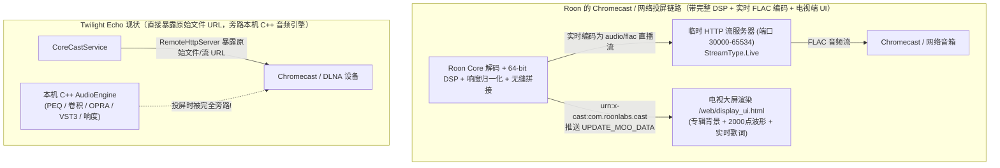

# Twilight Echo 与 Roon Server (2.0–2.74) 全方位差距与反超能力深度评估报告（V2 终极版）

评估日期：2026-10-26

对比基准：
- **Roon 侧**：
  1. [`D:/Project/res/roon-analysis`](file:///D:/Project/res/roon-analysis/docs/00-总览与索引.md)（Roon Server 2.73 Windows x64 全套 21 篇逆向工程报告与反编译源码 `00`–`15` + `附录A/B`）
  2. **Roon 官方社区线上发布日志（Roon 2.0 – Roon 2.74 Build 1712 / Roon ARC 1.84，截至 2026 年 10 月）**
- **Twilight Echo 侧**：[`D:/Project/Twilight_Echo`](file:///D:/Project/Twilight_Echo/README.md)（含已完成切换的**独立 Core 生产架构**、**M1–M5.3 统一音乐库工程**，以及工作区最新落地的 64-bit DSP / CLANS DSD / 2000 点波形 / SymSpell 检索增强）

---

## 0. 核心结论与里程碑完成状态标记

> [!IMPORTANT]
> **当前里程碑状态标记**：
> - **独立 Core 架构切换**：`[x] 已完成 ✅`（[`independent-core-progress.md`](file:///D:/Project/Twilight_Echo/docs/independent-core-progress.md)）
> - **统一音乐库 M1–M5.2（实体/资料/流派树/版本/评分/收藏禁播/标签/Focus/人物作品探索/v2 备份）**：`[x] 已完成接线 ✅`（[`unified-music-library-delivery-design.md`](file:///D:/Project/Twilight_Echo/docs/unified-music-library-delivery-design.md)）
> - **统一音乐库 M5.3（全库只读对账、后台 Worker 探针、日期补读合同、十万级混合曲库查询与分面）**：`[ ] 性能验收未通过`。对账、探针与 schema 29 日期补读已接入；Catalog／Genre／Focus 仍有秒级热点，人工内容和实际桌面／包内验收仍待完成（[`unified-music-library-m5.3.md`](file:///D:/Project/Twilight_Echo/docs/unified-music-library-m5.3.md)）。
> - **工作区最新音频与检索补齐（2000 点静态波形 + 首尾静音裁剪、64-bit 双精度 DSP + 7 阶 CLANS DSD512、SymSpell 纠错 + BM25 排序、曲库健康面板）**：`[x] 已在工作区落地 ✅`

**总体判断**：
1. **单机桌面 Hi-Fi 工作站维度已追平并局部反超 Roon**：在 64-bit 双精度 DSP 管线、CLANS 高阶 DSD512 调制、2000 点感知量化波形、二层 Gapless 静音裁剪、OPRA 耳机库及 SymSpell + BM25 检索上已与 Roon 2.73 对齐；在**进程外 VST3 插件宿主、等响度补偿 A/B 盲听、AI 4-Stem AutoMix 混音、音节级逐字歌词、中文/ACG 资料源生态**上已明显**反超 Roon**。
2. **音乐库核心数据模型已覆盖主要对照维度**：统一音乐实体、流派树、版本归并、半星个人评分 + 外部资料分、`favorite/ban/none` 三态偏好、Focus AST 组合筛选及古典 `Work/Performance/Credit` 导航已接线。十万级实测仍有性能阻塞项，真实内容、桌面交互与包内验收尚未完成；模型覆盖与交付完成应分别判断。
3. **结合全网资料（至 Roon 2.74）与逆向深水区（`07`–`15` 章及附录 A/B）深挖出的真实差距**，主要集中在以下 **7 大深水区**：
   - **（1）外网移动访问与车载生态（Roon ARC + MultiNAT 自动打洞 + Tailscale + CarPlay/Android Auto）**
   - **（2）Cast 投屏底层机制（Roon 实时 FLAC 重编码带 DSP 推流 + 电视端自定义 UI vs. Twilight Echo 原始文件 URL 直投旁路 DSP）与 9 大异构硬件传输协议矩阵（RAAT / AirPlay 2 / HQPlayer NAA / Songcast / Squeezebox / Devialet AIR）**
   - **（3）多房间并发播放与微秒级主从时钟同步（Multi-Zone & Clock Drift Compensation）**
   - **（4）客厅 10 英尺大屏展示系统（`/display/2` Web 端）与外部功放音量/信源/声学测量扩展协议（`volumecontrol:1` / `sourcecontrol:1` / `radiance:1`）**
   - **（5）曲库导入自愈与古典自动化深水区（内容 SHA-1 墓碑复活 `SIGNATURE_FILEKEY`、多碟目录自动折叠 `ClumpingUtils`、本地古典公共前缀拆乐章 `WorkPartMunger` + `KnownComposers` 白名单、iTunes XML 零拷贝导入）**
   - **（6）Roon 2.4x–2.74 最新产品特性（Box Sets 分碟独立封面与版本映射、流媒体曲目实时波形、Listen Later 稍后收听架、Smart Playlists 动态智能歌单、Daily Picks 每日回顾、混合文件夹浏览）**
   - **（7）本地特征向量无限电台算法（Local Swim 余弦相似度 + 防重复衰减）与艺人图片人脸焦点裁剪（Valence Art Director）**

---

## 一、整体架构、部署形态与并发模型（Architecture）

| 评估维度 | Roon Server 2.73–2.74 ([`00-总览`](file:///D:/Project/res/roon-analysis/docs/00-总览与索引.md) / [`06-MVCC`](file:///D:/Project/res/roon-analysis/docs/06-Remoting协议与MVCC并发内核.md)) | Twilight Echo 现状 ([`independent-core-progress.md`](file:///D:/Project/Twilight_Echo/docs/independent-core-progress.md)) | 差距评级与状态 |
| :--- | :--- | :--- | :--- |
| **宿主与无头部署（Docker / NAS）** | **三层纯无头守护进程**：`RoonServer` $\rightarrow$ `RoonAppliance`（.NET 10 Core）$\rightarrow$ `RAATServer`。**2026.04 起官方发布标准 Docker 镜像（`ghcr.io/roonlabs/roonserver`）**，支持群晖/Unraid/TrueNAS 一键无头部署。 | **Electron 主进程监督 + 多 `utilityProcess` 隔离**：[`src/main/index.ts`](file:///D:/Project/Twilight_Echo/src/main/index.ts) 启动受监管的 [`CoreApplication`](file:///D:/Project/Twilight_Echo/src/core/application.ts)（[`entry.ts`](file:///D:/Project/Twilight_Echo/src/main/coreProcess/entry.ts)）。支持 **Afterglow 零窗口后台运行**，但仍需 Electron 主进程作为宿主。 | **中**：[`src/core`](file:///D:/Project/Twilight_Echo/src/core/application.ts) 已实现零 DOM/Vue 依赖；若进一步提供脱离 Electron 的纯 Node CLI Headless 启动器与 Docker 镜像，即可像 Roon Server 一样部署在家庭 NAS。 |
| **并发与状态一致性** | **手写 6 线程无锁 MVCC**：`SharedState<THREAD>` 将全局状态切分为 6 条单写者线程，属性级脏位追踪 + `_prev` 弱引用历史版本链。 | **单写者 Core 事件循环 + SQLite/Addon 独立 Worker + CAS Revision 围栏**：通过 `epoch` + 域级 `revision` + `queryToken`（`STALE_REVISION`）+ M5.3 非阻塞后台读写保证并发安全。 | **已对齐 ✅（架构路线不同，并发语义等价）** |
| **客户端同步协议** | **Remoting V2 二进制对象图协议**：827 个 `TypeDescriptor`、FNV-1a 64 位字段增量 Diff、16 MiB 环形重连缓冲区（`REQ_RESUME`）。 | **有界 IPC / JSON 快照与分页投影**（[`coreProtocol.ts`](file:///D:/Project/Twilight_Echo/src/shared/coreProtocol.ts)）：本机多窗口零重放已完备；局域网走 [`CoreRemoteService`](file:///D:/Project/Twilight_Echo/src/core/remote/service.ts)。 | **小到中**：局域网 [`CoreRemoteService`](file:///D:/Project/Twilight_Echo/src/core/remote/service.ts) 目前仅暴露播放控制与基础浏览，尚未将完整 Catalog / Focus / DSP 编排能力投射给外部客户端。 |

---

## 二、核桥分离、Cast 投屏机制与异构音频输出矩阵（Core–Bridge & Transport）

通过深入比对 [`01-核桥分离.md`](file:///D:/Project/res/roon-analysis/docs/01-核桥分离.md)、[`07-RAAT协议与设备驱动.md`](file:///D:/Project/res/roon-analysis/docs/07-RAAT协议与设备驱动.md) 与 [`12b-Web前端与HTTP服务.md`](file:///D:/Project/res/roon-analysis/docs/12b-Web前端与HTTP服务.md)，我们发现了除 RAAT 之外**最关键的一处工程实现差距——Chromecast / 网络投屏的音频链路设计**：

| 维度 | Roon Server 2.73–2.74 | Twilight Echo 现状 | 差距深度解析 |
| :--- | :--- | :--- | :--- |
| **Cast 投屏的 DSP 与无缝连续性** | **`CastZonePlayer` 实时 FLAC 推流**（[`12b` §4.3](file:///D:/Project/res/roon-analysis/docs/12b-Web前端与HTTP服务.md)）：Core 在本地跑完解码、64-bit DSP、无缝跨轨后，实时编码为 **`"audio/flac"` 直播流（`StreamType.Live`）** 发给 Chromecast，并通过 `urn:x-cast:com.roonlabs.cast` 同步波形与歌词大屏 UI。 | **原始文件 HTTP Range 直投**（[`src/core/cast/service.ts`](file:///D:/Project/Twilight_Echo/src/core/cast/service.ts#L120-L140)）：远端设备直接拉取原始文件或上游流 URL。 | **大（高优改进点）**：当前投屏会**完全绕过本机 C++ 引擎的 PEQ、卷积、OPRA、VST3 与响度归一化**，且无法投放 CUE 分轨和 SACD ISO 子轨（见 [`service.ts` L129-L130](file:///D:/Project/Twilight_Echo/src/core/cast/service.ts#L129-L130)）。 |
| **本机与远程音频桥统一性（RAAT）** | 本机 `RAATServer` 与局域网 `Roon Bridge` 完全同构（`SOOD` 组播发现 + TCP 控制 + UDP 音频/时钟流）。 | 本机走 [`audioEngineService.ts`](file:///D:/Project/Twilight_Echo/src/main/services/audioEngineService.ts)；尚无独立打包的跨平台轻量级 `Twilight Bridge` 远程声卡接收端。 | **大**：无法在局域网另一台树莓派或数播上挂载远程 ASIO/WASAPI/ALSA 声卡并由主控机算完 DSP 后推流。 |
| **异构网络音频协议矩阵** | 原生支持 **9 大协议**（[`07-RAAT` §10](file:///D:/Project/res/roon-analysis/docs/07-RAAT协议与设备驱动.md)）： 1. **RAAT** 2. **AirPlay 1 & 2**（RTSP + ChaCha20-Poly1305 + HomeKit PIN 配对，2.73.2 刚适配 tvOS 27） 3. **Chromecast** 4. **HQPlayer NAA / Control**（外接 HQPlayer 极限升频，Ed25519 双向验签） 5. **Linn Songcast Direct**（`ohNet` + `scd://`） 6. **Squeezebox**（内置 `SlimProto` 服务端） 7. **Devialet AIR**（`roondevialet.dll` CHM 帧 + UDP NAK 重传） 8. **Sonos / KEF** 9. **Meridian IPNP** | 目前支持 **DLNA/UPnP** 与 **Chromecast**（[`src/core/cast/`](file:///D:/Project/Twilight_Echo/src/core/cast/service.ts)）。 | **中到大**：对于桌面发烧友，**AirPlay 2** 与 **HQPlayer 外部升频联动** 是除 RAAT/DLNA 外最常被提及的两项协议。 |
| **多房间（Multi-Zone）与主从时钟同步** | 支持多 `Zone` 同时播放不同队列；同 Zone 多设备编组通过 UDP `clock_port` 做 RTT 滤波与 ppm 级时钟漂移实时重采样纠偏。 | **单播放会话 + 单活动输出目标**（[`src/core/cast/service.ts` L30-L32](file:///D:/Project/Twilight_Echo/src/core/cast/service.ts#L30-L32)）。 | **大**：不支持多房间独立并发播放与多终端微秒级同步编组。 |

---

## 三、外网移动访问与车载生态（Roon ARC vs. 局域网 Remote）

对照 [`08-服务发现与网络.md`](file:///D:/Project/res/roon-analysis/docs/08-服务发现与网络.md) §7、[`14-授权认证与加密.md`](file:///D:/Project/res/roon-analysis/docs/14-授权认证与加密.md) §2.2b 与 Roon 2.0–2.74 线上发布记录，**Roon ARC（Audio Roon Core）** 是 Roon 2.0 时代最核心的生态护城河之一：

| 能力维度 | Roon 2.74 + Roon ARC 1.84 | Twilight Echo 现状 | 差距说明 |
| :--- | :--- | :--- | :--- |
| **出门在外访问家庭曲库（Remote Streaming）** | 手机在 4G/5G 蜂窝网络下直连家庭 Core，完整浏览家里的百万级曲库、流媒体、Focus 与智能歌单；支持**根据蜂窝/Wi-Fi 网络自动实时转码（Opus/MP3）或原盘无损串流**，支持专辑离线下载到手机。 | [`CoreRemoteService`](file:///D:/Project/Twilight_Echo/src/core/remote/service.ts) 仅限**家庭局域网（LAN）内遥控本机播放**，不支持把音频流传输到手机端播放，也不支持外网访问。 | **大（生态级差距）** |
| **全自动 NAT 穿透（`MultiNAT`）与 Tailscale 集成** | Core 内置 [`Roon.MultiNAT`](file:///D:/Project/res/roon-analysis/docs/08-服务发现与网络.md)：自动尝试 **UPnP IGD**（含多级路由 Traceroute 探测 + 网关端口扫描兜底）+ **NAT-PMP** + **IPv6 防火墙自动打洞（`WANIPv6FirewallControl`）** + 云端回环连通性自检；同时内置 [`TailscaleHealth.cs`](file:///D:/Project/res/roon-analysis/docs/08-服务发现与网络.md) 原生支持 Tailscale 虚拟局域网穿透 CG-NAT。 | 无外网打洞、无动态转码网关。 | **中**：桌面应用若想低成本支持手机外网听家里曲库，无需手搓复杂 UPnP 打洞，只需让 HTTP 网关支持“手机端拉取音频流（Web Audio Player）+ Tailscale 局域网直连”即可实现 80% 的 ARC 体验！ |
| **车载 CarPlay 与 Android Auto** | Roon 2.74（2026.10）刚刚**从零重写了 CarPlay 与 Android Auto 车载应用底座**，支持车机大屏浏览曲库、语音搜索与断线无缝重连。 | 尚无独立移动端 App，无 CarPlay / Android Auto 车载集成。 | **大（需独立移动端 App 支撑）** |

---

## 四、客厅大屏展示与外设硬件联动扩展生态（Display & Extensions）

深入阅读 [`10-RoonApi与扩展生态.md`](file:///D:/Project/res/roon-analysis/docs/10-RoonApi与扩展生态.md) 与 [`12b-Web前端与HTTP服务.md`](file:///D:/Project/res/roon-analysis/docs/12b-Web前端与HTTP服务.md) 后，发现 Roon 在“客厅 Hi-Fi 硬件联动”上有四个非常巧妙的设计：

| 序号 | Roon 硬件联动与大屏特性 | 逆向源码与实现机制 | Twilight Echo 现状与借鉴价值 |
| :---: | :--- | :--- | :--- |
| **1** | **Web 客厅 10 英尺大屏展示端（Zone Display `/display/2/`）** | Core 内置 HTTP 服务挂载了原生编译的 **Vue 3 + TypeScript 大屏 SPA（`/display/2/`）**（[`12b` §2.3](file:///D:/Project/res/roon-analysis/docs/12b-Web前端与HTTP服务.md)）。家里任何智能电视、平板或副屏浏览器打开该网址，即可通过 `com.roonlabs.zonedisplay:1` 绑定任意播放区，展示全屏动态背景、艺人头像、**2000 点动态波形进度条**、实时滚动歌词，并内置电视遥控器方向键提示（`KeybindOverlay`）。 | **极易借鉴（高颜值低成本 🌟）**：Twilight Echo 已经有极其惊艳的逐字歌词和渲染器视觉组件，只需在 [`CoreRemoteService`](file:///D:/Project/Twilight_Echo/src/core/remote/service.ts) 的内嵌网页中增加一个 `/display` 纯大屏展示路由，就能让用户的智能电视或 iPad 秒变客厅 Hi-Fi 歌词/波形大屏！ |
| **2** | **外部功放/前级硬件音量与信源联动（`volumecontrol:1` & `sourcecontrol:1`）** | 当高阶发烧友使用 USB DAC **Bit-Perfect 固定电平（Fixed Volume）** 直通输出给外部模拟功放/AV 接收机（如 Denon / Marantz / Rotel / Accuphase / Home Assistant）时，Roon 允许扩展插件注册外部音量控制器与信源开关（[`10-RoonApi` §4b](file:///D:/Project/res/roon-analysis/docs/10-RoonApi与扩展生态.md)）。用户在软件里拖音量条或点播放，直接通过网络/串口调节物理功放的音量并自动开机切通道，**既保住了 DAC 的 Bit-Perfect，又拥有软件音量滑块的便利**！ | **中（发烧友痛点杀手锏）**：目前 [`packages/plugin-api`](file:///D:/Project/Twilight_Echo/packages/plugin-api/src/index.ts) 尚无 `ExternalVolumeProvider` / `ExternalSourceControl` 钩子。加入这一轻量级扩展接口后，即可轻松对接 Home Assistant 或网络功放。 |
| **3** | **自动化房间声学测量接口（`com.roonlabs.radiance:1`）** | 暴露 `begin_measurement`、`play_measurement_signal`、`submit_measurement_signal`、`reflect_measured_volume`（[`10-RoonApi` §4c](file:///D:/Project/res/roon-analysis/docs/10-RoonApi与扩展生态.md)），让房间声学校正工具直接通过播放器发测量扫频信号并自动生成 FIR 卷积滤波器。 | **小到中**：未来可与内置的卷积器（Convolution）和 PEQ 结合，提供向导式房间/耳机频响校准。 |
| **4** | **外部硬件音源输入注入（`com.roonlabs.audioinput:1`）** | 允许外部黑胶唱机 ADC 流、网络 CD 转盘（如 RooExtend）将实时音频流作为虚拟输入源注入播放器，享受全套 DSP 与房间校正。 | **小**：桌面端可通过声卡 Loopback / ASIO Input 实现类似功能。 |

---

## 五、音频全链路与 MUSE DSP 引擎细节对比（Audio Pipeline & DSP）

对照 [`02-音频实现全链路.md`](file:///D:/Project/res/roon-analysis/docs/02-音频实现全链路.md)、[`03-DSP与音效处理实现.md`](file:///D:/Project/res/roon-analysis/docs/03-DSP与音效处理实现.md) 与 Roon 2.74 最新动态，Twilight Echo 在音频引擎上已极其强悍，仅剩几处细节差异：

| 音频/DSP 能力 | Roon Server 2.73–2.74 (MUSE Engine) | Twilight Echo 现状 ([`audio-engine/`](file:///D:/Project/Twilight_Echo/audio-engine/core/TwilightAudioEngine.cpp)) | 状态对比 |
| :--- | :--- | :--- | :--- |
| **64-bit 双精度浮点管线 + TPDF 抖动** | 32-bit 升为 64-bit `double` 贯穿 DSP 链，末端 TPDF 抖动。 | [`DspChain::processDouble`](file:///D:/Project/Twilight_Echo/audio-engine/dsp/DspChain.h#L30) 全链路 64-bit `double` 处理 + TPDF 抖动。 | **已对齐 ✅** |
| **DSD512 升频与 7 阶 CLANS 闭环调制器** | 支持 DSD64–DSD512，提供 5/7 阶普通调制器与 **5/7 阶 CLANS 闭环噪声整形器**。 | [`PcmToDsdModulator.h`](file:///D:/Project/Twilight_Echo/audio-engine/dsp/PcmToDsdModulator.h#L14-L45) 已实现 6 级半带多相 FIR 升频（DSD64–DSD512）+ **5 阶 CIFB 与 7 阶 CLANS 风格 CIFB 调制器** + 失稳自恢复保护。 | **已对齐 ✅** |
| **2000 点静态波形与二层静音裁剪** | 本地文件提取 2000 点波形与 `noiseStartMs / noiseEndMs`；**Roon 2.74 新增：流媒体未入库曲目也支持显示静态波形，并优化极安静/极响录音的动态缩放**。 | [`LoudnessAnalyzer.cpp`](file:///D:/Project/Twilight_Echo/audio-engine/analysis/LoudnessAnalyzer.cpp#L48-L87) 与 [`waveformPeaks.ts`](file:///D:/Project/Twilight_Echo/src/shared/waveformPeaks.ts#L1-L100) 已实现本地曲目 2000 点感知量化波形与 `-72 dBFS` 二层静音裁剪；**流媒体在线曲目边播边生成全局 2000 点静态波形尚未覆盖**。 | **本地已对齐 ✅ / 流媒体波形待补充** |
| **OPRA 耳机预设与母带级效果器** | 内置 PEQ、FIR 卷积、Crossfeed、Audeze 预设、OPRA 耳机库（Roon 2.0.43 引入）。 | 内置 32 段 PEQ + **动态 EQ**、分区 FIR 卷积、Crossfeed、OPRA 耳机库（[`src/core/opra/service.ts`](file:///D:/Project/Twilight_Echo/src/core/opra/service.ts)）、**多段压缩、低音管理、等响度曲线、进程外 VST3 宿主、等响度 A/B 盲听**。 | **大幅反超 Roon 🌟** |
| **MUSE Procedural EQ（程序化分声道/Mid-Side 路由）与分采样率族规则** | 支持在单个 Procedural EQ 节点内对任意声道独立挂 PEQ、做 **Mid/Side 编解码（M/S 处理）**、声道物理距离延迟（`34.32 cm/ms`）、按 **$44.1\text{kHz}$ 与 $48\text{kHz}$ 采样率族分别指定目标倍频（Max Power-of-2）**，以及 Headroom 历史削波百分比统计。 | 已具备 `ChannelMatrixProcessor` 与 `ChannelStripProcessor`（[`DspChain.h` L87-L90](file:///D:/Project/Twilight_Echo/audio-engine/dsp/DspChain.h#L87-L90)），但 UI 上尚未提供“Mid/Side 独立 EQ 模式”、“音箱距离厘米换算延迟”以及“按 44.1k/48k 家族分别设定升频上限”的快捷开关。 | **小（纯配置与参数映射层细节）** |

---

## 六、音乐库、导入自愈、古典深水区与 Roon 2.74 新特性对比（Music Library）

结合 [`05-音乐库与元数据实现.md`](file:///D:/Project/res/roon-analysis/docs/05-音乐库与元数据实现.md)、[`附录B-音乐库实现补充笔记.md`](file:///D:/Project/res/roon-analysis/docs/附录B-音乐库实现补充笔记.md)、[`09a/09b`](file:///D:/Project/res/roon-analysis/docs/09a-流媒体集成-Tidal与Qobuz.md) 以及 **Roon 2.42–2.74（截至 2026.10）** 的最新线上功能，以 **M1–M5.3 当前接线与实测状态** 对比如下：

| 评估维度 | Roon Server 2.73–2.74 | Twilight Echo 现状（功能接线与验收分列） | 差距深度解析 |
| :--- | :--- | :--- | :--- |
| **统一音乐实体、流派树、评分、偏好、Focus 与十万级性能（M1–M5.3）** | 3 层元数据 + 单父流派树 + 个人/资料双层评分 + `Favorite/Ban` + Focus + 全内存对象图。 | 统一实体与来源绑定、可编辑流派树、半星个人评分与外部资料分、`favorite/ban/none` 三态偏好、Focus AST 查询、全库只读对账（[`libraryDatabaseReconciliation.ts`](file:///D:/Project/Twilight_Echo/src/main/library/libraryDatabaseReconciliation.ts)）、后台读取探针、schema 29 日期补读、十万级窄分页与单次 `CASE` 分面已接入；目录／分面仍有秒级热点。 | **数据模型已接线；M5.3 性能及实际内容／UI／包内验收未完成** |
| **Box Sets（套装盒集）与多碟分碟独立封面/版本映射（Roon 2.74，2026.10 最新上线）** | **Roon 2.74 重磅新特性**： 1. 盒集中的每一张 Disc（CD1/CD2）可拥有**独立的分碟标题（`DISCSUBTITLE` 或目录名 `CD1 - Pearl`）、独立的单碟封面（Disc Art）和独立年份**。 2. 可将盒集中的某张 Disc 直接关联到曲库/流媒体中的某张独立正式专辑，自动继承其封面、年份与其它版本链接。 3. `Now Playing` 新增 **Disc Art 画中画模式**（大图显示当前分碟封面，角标显示盒集外盒封面）。 | 目前支持多碟 `discNumber` 分组与版本组（Release Group），但 `album_disc` 层级尚未独立存储**单碟专属封面（Disc Cover）、单碟副标题、单碟独立发行年以及单碟指向另一张独立 Album 的关联映射**。 | **中（Roon 2026.10 刚上线的新标杆，非常适合古典/爵士大全集与 ACG Box Set）** |
| **音频内容 SHA-1 签名“墓碑复活”（`SIGNATURE_FILEKEY`）** | 当文件跨盘迁移、改名或先删后加时，[`MediaFilesAddedWork.cs`](file:///D:/Project/res/roon-analysis/docs/附录B-音乐库实现补充笔记.md) 计算**纯音频内容 SHA-1 签名**并在墓碑记录中匹配旧 `LocalTrack`（优先恢复 `TrackIsEdited`），**自动复活历史播放次数、首次入库时间（`InternalCreateTimestamp`）、手工编辑与歌单引用**。 | 目前主要依赖路径/文件特征与曲库健康面板（[` libraryHealthService.ts`](file:///D:/Project/Twilight_Echo/src/core/library/libraryHealthService.ts)）的缺失文件重定位，尚未对删除曲目保留基于纯音频流 SHA-1 哈希的自动墓碑复活链。 | **小到中（极佳的防丢数据体验）** |
| **多碟目录自动向上折叠与位图连续性聚簇（`ClumpingUtils`）** | 扫描本地目录时自动识别 `CD1`、`Disc 2`、`Artwork`、`Scans` 子文件夹并向上折叠进父目录专辑簇（[`附录B` §2](file:///D:/Project/res/roon-analysis/docs/附录B-音乐库实现补充笔记.md)）；利用 `ContiguousTrackHelper`（64 位位图检验轨号连续无空洞）与 `MajorityVote` 多数派投票解决脏标签分簇。 | 已支持完整专辑与子集校验（[`musicIdentificationAlbumSubset.ts`](file:///D:/Project/Twilight_Echo/src/core/library/musicIdentificationAlbumSubset.ts)）与收件箱治理，但对物理子目录 `CD1/CD2` 缺失 Album 标签时的目录折叠与位图连续性启发式聚簇可进一步增强。 | **小** |
| **古典乐章公共前缀拆解（`WorkPartMunger`）+ 作曲家白名单门控 + 编制（`Instrumentation`）** | 内置 `known_composers.json` 白名单（[`附录B` §7](file:///D:/Project/res/roon-analysis/docs/附录B-音乐库实现补充笔记.md)）：仅当 Composer 命中白名单或流派为古典时，才通过相邻曲目**最长公共前缀 + 罗马数字乐章号**自动将散装本地音轨组装为多乐章 `Work`（防止把流行歌 `Written by` 误判为古典交响乐）；内置海顿 `Hob.` / `BWV` / `Op.` 解析器与 `Instrumentation`（乐器编制，如“弦乐四重奏”）筛选维度。 | 已完成 `Work` / `Performance` / `Credit` 深度探索与参与度统计（[`explorationService.ts`](file:///D:/Project/Twilight_Echo/src/core/library/explorationService.ts)），当前遵循“不从曲名猜虚构演绎”的稳健原则；若未来想对无 MusicBrainz 绑定的本地古典抓轨做自动分乐章，“`KnownComposers` 白名单门控 + 公共前缀合并”是极佳参考。 | **小到中（仅针对无外部关联的纯本地古典抓轨）** |
| **流媒体整库增量镜像同步与 256 KiB AES 加密分页缓存** | Tidal / Qobuz / KKBOX / nugs.net 收藏通过 `sync_token` 增量镜像进本地统一库；流媒体缓存按 256 KiB 分页并用进程临时 AES 密钥加密落盘（[`StreamingMediaCache.cs`](file:///D:/Project/res/roon-analysis/docs/09a-流媒体集成-Tidal与Qobuz.md)）。 | 已支持跨平台在线音源融合入库与本地缓存管理。 | **已对齐 ✅** |
| **iTunes / Apple Music `iTunes Library.xml` 零拷贝导入** | 通过 `MemoryMappedFile` 零 DOM 扫描 `iTunes Library.xml`（[`09b` §4](file:///D:/Project/res/roon-analysis/docs/09b-流媒体集成-KKBOX-iTunes-电台.md)），一键迁移 Apple Music 老用户的历史播放次数、入库时间与歌单。 | 目前支持自身的 v2 JSON 个人数据备份恢复与标准 M3U/通用歌单导入，尚无专门针对 `iTunes Library.xml` 播放次数与入库时间的迁移器。 | **小（按需补充）** |

---

## 七、产品发现体验与日常交互细节差距（Roon 2.0–2.74 线上特性全集）

通过梳理 Roon 官网及社区 2024–2026 年的更新日志与 [`11a`](file:///D:/Project/res/roon-analysis/docs/11a-特色功能-Browse与内容元信息.md) / [`11b`](file:///D:/Project/res/roon-analysis/docs/11b-特色功能-Radio推荐播客与多区.md) 反编译代码，以下是除底层架构外，Roon 在**日常音乐把玩与发现体验**上的特色功能清单：

| 序号 | Roon 特色产品功能 | 具体体验与逆向机制 | Twilight Echo 当前状态与补齐难度 |
| :---: | :--- | :--- | :--- |
| **1** | **Listen Later（稍后收听架，Roon 2.0.46 上线）** | 独立于“收藏（Favorite）”与“歌单”的**个人音乐待办清单（To-Do List）**（[`BrowseService_2.cs` L330](file:///D:/Project/res/roon-analysis/docs/11a-特色功能-Browse与内容元信息.md)）。逛流媒体或朋友推荐时看到感兴趣的专辑/单曲，一键加入 `Listen Later`；区分“未听（Unheard）”与“已听（Heard）”，听完后可归档或转正式收藏，避免把没听过的专辑塞满收藏夹。 | **小（极高产品价值 🌟）**：在数据库增加一张轻量级 `listen_later_item` 表并在侧边栏/专辑右键菜单提供入口，半天即可落地。 |
| **2** | **Smart Playlists（动态智能歌单，Roon 2.0.42 上线）** | 将 Focus 筛选条件保存为**一级动态智能歌单**（如“从未听过的 5 星古典”、“最近一个月入库的无损 ACG”），随曲库变动实时自动更新曲目列表，且支持像普通歌单一样自定义封面（Roon 2.73）、一键播放与导出。 | **小（水到渠成 🌟）**：你已经在 M3.2 完成了完整的参数化 Focus AST 与预设（Preset），只需允许将 Focus Preset 提升为侧边栏的 `Smart Playlist` 即可！ |
| **3** | **Local Swim 本地特征向量无限电台（[`RadioSession.cs`](file:///D:/Project/res/roon-analysis/decompiled/Roon.Broker.Core/Roon.Broker.Music.Radio/RadioSession.cs)）** | 当无网络或播放纯本地曲目时，将曲库曲目编码为稀疏特征向量（主艺人 `0.4`、流派 `1.0`、子流派 `2.0`、关联艺人 `0.7`、作曲家 `1.0`、年代高斯衰减 $\sigma=0.35$），计算余弦相似度并乘以自适应防重复惩罚 $f = (1/(1+c))^{\min(1, 200/|T|)}$，实现纯本地曲库的无限电台漫游。 | **中（高优推荐 🌟）**：直接复用 M1–M4 已落库的流派树、Credits、年份与播放次数，在 [`PersonalizedQueue`](file:///D:/Project/Twilight_Echo/src/core/playback/personalizedQueue.ts) 中增加本地特征余弦相似度选曲器。 |
| **4** | **Daily Picks（每日回顾卡片，Roon 2.71 上线）** | 每天早晨在首页生成 3–5 组从用户**过去几周常听**与**数月前被遗忘的高分收藏**中抽取出的数据驱动推荐卡片，并明确标注推荐溯源理由（Provenance）。 | **小**：基于现有 `play_history` 与 `user_preference` 即可在首页生成每日回顾卡片。 |
| **5** | **Valence Art Director（艺人照片人脸焦点框裁剪）** | 艺人图片带有**圆形头像焦点框（Avatar Focus）**与 **16:9 横幅焦点框（Banner Focus）**坐标，确保无论在宽屏详情页横幅还是圆形小头像中，艺人的脸部永远居中、绝不出现“切头顶/留胸口”的尴尬裁剪。 | **小（视觉精致度加分项）**：可在艺人图片元数据中支持 `focusPointX / focusPointY`（或前端轻量级人脸/显著性中心点检测设置 `object-position`）。 |
| **6** | **艺人合作者网络（Collaborators）与传记内联实体超链接** | 在艺人页统计全库 Credits 共现频次，展示“**最常合作的指挥/乐手/制作人（Collaborators）**”；同时在渲染艺人传记（Biography）和专辑乐评时，将文中出现的其它艺人名、专辑名、作品名自动渲染为可点击跳转的内部链接。 | **小到中**：`Credit` 表已就绪，通过一条共现聚合 SQL 即可算出某艺人的 Top Collaborators！ |
| **7** | **混合文件夹浏览（Folder Browsing，Roon 2.0.36 上线）** | 允许按硬盘物理目录树逐级浏览，但目录列表项直接展示已入库的富元数据（专辑封面、艺人、音质徽章），兼顾文件夹党的习惯与音乐库的颜值。 | **小**：在现有文件夹视图上关联 `track_source_binding` 投影即可。 |
| **8** | **专辑 `.pdf` 数字内页（Booklets）与 Live Radio ICY 实时识曲（`Slurp`）** | 自动扫描专辑目录下的 `.pdf` 宣传册与多图扫图并在专辑页内嵌阅读；播放网络电台时解析 ICY `StreamTitle` 实时反查曲库转化为可点击的歌曲/艺人链接。 | **小**：两个独立的体验甜点功能。 |

---

## 八、Twilight Echo 独有、而 Roon 2.74 仍缺失的 5 大王牌优势

在看到 Roon 深水区积累的同时，必须明确 **Twilight Echo 在以下 5 个核心维度已经领先于 Roon 2.74**：

1. **Twilight AutoMix（AI 4-Stem 分轨与节拍网格对齐混音）**：Roon 至今仅有最原始的固定秒数淡入淡出（Crossfade），完全不具备 AI 人声/伴奏实时分轨、BPM 节拍对齐与时间伸缩无缝混音。
2. **进程外 VST3 插件宿主与现代动态母带链**：[`HostMain.cpp`](file:///D:/Project/Twilight_Echo/audio-engine/vst-host/HostMain.cpp) 支持挂载专业 VST3 插件（FabFilter、Ozone 等）并具备共享内存隔离与崩溃软旁路，且内置动态 EQ（`DynamicEqProcessor`）、多段压缩（`MultibandCompressorProcessor`）、等响度曲线（`LoudnessContourProcessor`），可玩性远超 Roon 封闭的内置 DSP。
3. **等响度补偿 A/B 盲听（[`DspAuditionManager.h`](file:///D:/Project/Twilight_Echo/audio-engine/include/DspAuditionManager.h)）**：基于实时 `libebur128` 短期 LUFS 自动对齐干湿信号响度，彻底消除“声音变大所以觉得好听”的心理声学假象——Roon 完全没有此能力。
4. **音节级逐字歌词、双语/罗马音排版与桌面悬浮歌词窗**：Roon 的歌词仅能按行粗略滚动，不支持逐字染色、卡拉 OK 级动效、双语对照与桌面常驻悬浮窗。
5. **原生中文/ACG 资料源（MusicBrainz + Wikidata + VocaDB + NCM）与开放 UI/音源插件生态**：Roon 强绑定欧美流媒体（Tidal/Qobuz）与英文 TiVo/AllMusic 数据源，对国内流媒体生态、Vocaloid/同人音乐（VocaDB）以及拼音首字母检索的支持远不及 Twilight Echo。

---

## 九、基于现有音乐库底座的演进建议优先级（含二轮深挖高价值特性）

**独立 Core** 已完成切换，音乐库功能与 2000 点波形、64-bit CLANS-style DSD、SymSpell 检索已接入。M5.3 性能优化按 2026-10-25 的用户安排暂停；恢复后优先收尾 Focus 爵士筛选与流派全量构图，实际内容／桌面／包内验收仍需完成。以下扩展建议按**“投入产出比（ROI）”**分为三个梯队：

### 第一梯队：低成本、极高感知度的产品甜点（利用现有 M1–M5.3 底座即可快速兑现）
1. **Smart Playlists（动态智能歌单）**：直接将已完成的 Focus 预设（Focus Preset）提升为可固定在侧边栏、支持自定义封面与一键播放的动态智能歌单。
2. **Listen Later（稍后收听架）**：新增轻量级待办收听列表（区分未听/已听），解决用户看到好专辑想先记下来但不想污染收藏夹的高频需求。
3. **Local Swim 本地特征向量电台 + 艺人 Collaborators（合作者关系网）**：利用已建好的流派树、Credits、年代与评分，实现纯本地余弦相似度无限漫游电台，并在人物详情页增加“常驻合作者（Top Collaborators）”聚合栏与 Daily Picks 每日回顾。
4. **Web 客厅大屏模式（`/display` 路由）**：在 [`CoreRemoteService`](file:///D:/Project/Twilight_Echo/src/core/remote/service.ts) 中复用现有的高颜值歌词、封面背景与 2000 点静态波形组件，提供一个免登录/PIN 绑定的全屏展示网页，让家里的智能电视或 iPad 秒变客厅 10 英尺正在播放大屏。

### 第二梯队：音频投屏闭环与典藏级曲库增强
5. **Cast 投屏的“实时 FLAC 引擎渲染流”模式**：参照 Roon `CastZonePlayer`，在 [`CoreCastService`](file:///D:/Project/Twilight_Echo/src/core/cast/service.ts) 中支持将本机 C++ 引擎经过 PEQ / 卷积 / VST3 / 响度平衡渲染后的音频实时编码为 HTTP FLAC 直播流推给 Chromecast/DLNA，彻底打通远程投屏的 DSP 链路与 CUE/SACD 子轨播放。
6. **Box Sets 分碟独立封面/标题/版本关联（对齐 Roon 2.74）+ 专辑 PDF Booklet 阅读器**：支持在多碟盒集中为单张 Disc 配置独立封面（`DISCSUBTITLE` / 子目录封面）与 Now Playing 画中画切换，并支持内嵌翻阅专辑目录下的 `.pdf` 宣传册。
7. **音频内容 SHA-1 墓碑复活与古典 `KnownComposers` 公共前缀分乐章**：在删除曲目时保留纯音频流哈希墓碑，文件跨盘迁移时自动恢复播放统计与手工编辑；对命中已知古典作曲家白名单的本地专辑提供可选的曲名公共前缀乐章折叠。

### 第三梯队：跨设备与硬件生态级演进（长期战略方向）
8. **外部功放音量/信源控制扩展钩子（`ExternalVolumeProvider`）**：允许插件在 DAC 固定电平（Bit-Perfect）输出时接管音量滑块，联动控制外部功放或 Home Assistant。
9. **轻量级外网访问（Web Audio 串流 + Tailscale 指引）与独立 `Twilight Bridge` 守护进程**：让 [`CoreRemoteService`](file:///D:/Project/Twilight_Echo/src/core/remote/service.ts) 支持在手机浏览器/PWA 中直接拉取转码或无损音频流播放（配合 Tailscale 即可零成本实现出门在外听家庭 Core 曲库），并逐步演化出纯 Headless Server / Docker 镜像与跨局域网音频桥。
