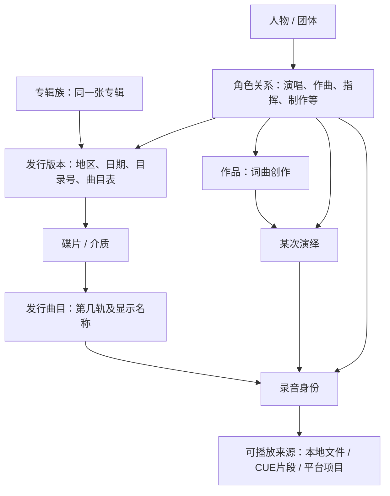

# Roon 音乐库的层级、分类与评分：Twilight Echo 实现方案

研究日期：2026-10-23。依据用户提供的 `D:/Project/res/roon-analysis` 分析及反编译源码，并对照当前 Twilight Echo。本文是研究与设计，不修改业务代码，也不涉及正在推进的独立 Core 重构。

**结论：值得学习的是统一的音乐实体、分类体系、用户偏好与查询机制。仅增加星级控件和几个分类页面，无法形成 Roon 那样可探索、可管理的音乐库。** Twilight 已有 SQLite、分页、录音身份匹配、版本与来源偏好，适合在这些基础上逐步增加模型。

证据分为两类：下文“Roon 已核实”指这份源码快照支持的行为；“Twilight 建议”是本项目的设计选择。服务端存在某个接口，并不证明当前所有 Roon 客户端都有相应操作入口。

## 1. “分级”实际上包含六个互相独立的维度

| 维度 | 回答的问题 | 示例 | 建模方式 |
|---|---|---|---|
| 音乐实体关系 | 它是什么、是谁参与的？ | 作品、演绎、录音、专辑、人物、制作角色 | 实体与关系 |
| 发行和版本 | 这份内容是哪一版？ | 原版、豪华版、再版；同一录音的本地/平台来源 | 版本关系、首选版本、来源可用性 |
| 流派分类 | 它属于什么音乐风格？ | Jazz → Bebop；一张专辑可以属于多个流派 | 流派树＋多对多关联 |
| 人工整理 | 我如何组织它？ | 夜间、试音、待整理；播放清单 | 标签、歌单、保存的筛选 |
| 评价和偏好 | 我觉得怎样、是否愿意再听？ | 个人评分、基础评分、收藏、禁播 | 按用户存储的偏好＋带来源的评分 |
| 技术和管理属性 | 文件怎样、库是否完整？ | FLAC、24/96、缺封面、未识别、重复版本 | 来源属性和管理状态 |

这些维度可组合，不能互相代替。例如“爵士、现场、24/96、我打四星、尚未听过”描述同一张专辑的不同方面；采样率不会自动决定音乐评分，收藏也不自动等于五星。

## 2. 音乐实体：目录树之外还需要关系网

Roon 已核实：

- `LibraryWork` 关联作曲者和多次 `Performance`；`LibraryPerformance` 再关联一组轨道。作品、演绎和可播放轨道不是同一个对象。见 [LibraryWork.cs](D:/Project/res/roon-analysis/decompiled/Roon.Broker.Core/Roon.Broker.Music/LibraryWork.cs:107)、[LibraryPerformance.cs](D:/Project/res/roon-analysis/decompiled/Roon.Broker.Core/Roon.Broker.Music/LibraryPerformance.cs:47)。
- 专辑有 `Duplicates`、`DuplicateOf`、`IsPrimaryVersion`，首选版本还参与内部版本排序值。见 [LibraryAlbum.cs](D:/Project/res/roon-analysis/decompiled/Roon.Broker.Core/Roon.Broker.Music/LibraryAlbum.cs:388)。这不代表音质数值能衡量演绎或母带的艺术价值。
- 专辑类型枚举包含 Main、Single、Compilation、ExtendedPlay、Soundtrack、Show、Other、Unknown；现场和 Bootleg 等又有独立状态。见 [AlbumType.cs](D:/Project/res/roon-analysis/decompiled/Roon.Broker.Api/Roon.Broker.Api/AlbumType.cs:3)、[LibraryAlbumMatcher.cs](D:/Project/res/roon-analysis/decompiled/Roon.Broker.Core/Roon.Broker.Music/LibraryAlbumMatcher.cs:370)。

Twilight 建议采用下列概念关系。**这是建议的数据模型，不是宣称 Roon 内部表名与 MusicBrainz 完全相同。**



关键边界：

1. 同一录音可以出现在原专辑和精选集里，因此“录音”不能只属于一张专辑；发行曲目负责曲序和所在版本。
2. 同名歌曲的现场版、翻唱、录音室版不能仅凭标题合并。重制母带是否合并到同一录音，要有独立版本描述，不能只由 FLAC/MP3 判断。
3. 古典音乐的一次完整演绎可以跨多个轨道；曲目中的乐章标题不能代替作品身份。作品/演绎/录音的关联应允许多条关系和顺序。
4. 文件夹负责定位文件，不承担人物、作品、发行版本的身份。没有外部 ID 的条目也应能先作为本地实体入库。
5. 人物是一个实体，作曲者、歌手、指挥、制作人是角色。同一人可担任多个角色；艺术家页可按角色分组展示其参与的专辑。

现有 [musicVersions.ts](D:/Project/Twilight_Echo/src/shared/musicVersions.ts:1) 已有 `MusicVersion → sources` 和 `VersionFamily → versions`、`preferredSource`、`preferredVersion`；[recordingIdentity.ts](D:/Project/Twilight_Echo/src/shared/recordingIdentity.ts:40) 已处理手动版本与部分录音差异。应保留这些身份与用户选择，再引入长期稳定的实体 ID。不要因改名、补齐元数据或移动文件而丢失评分和收藏。

## 3. 流派层级：单父树、多值关联、原始值映射

Roon 已核实：

- 每个 `LibraryGenre` 有一个 `Parent` 和多个 `Subgenres`，还有层级与顶层标记；这份实现是**单父层级**，不能据此说它采用多父分类图。见 [LibraryGenre.cs](D:/Project/res/roon-analysis/decompiled/Roon.Broker.Core/Roon.Broker.Music/LibraryGenre.cs:87)。
- 选 Jazz 可以匹配只直接标记为某个 Jazz 子流派的专辑：专辑匹配器使用 `album.Genres.WithAncestry()`，支持包含/排除及 AND/OR。见 [LibraryAlbumMatcher.cs](D:/Project/res/roon-analysis/decompiled/Roon.Broker.Core/Roon.Broker.Music/LibraryAlbumMatcher.cs:438)。
- 云端层级与用户覆盖分开保存，允许覆盖父流派、清除原父级、覆盖描述。见 [GenreHierarchy.cs](D:/Project/res/roon-analysis/decompiled/Roon.Broker.Core/Roon.Broker.Music/GenreHierarchy.cs:166)。
- 原始流派有映射表，可把本地字符串映射到库中的分类；映射改变会重算专辑、人物和相关标签。见 [GenreMappings.cs](D:/Project/res/roon-analysis/decompiled/Roon.Broker.Core/Roon.Broker.Music/GenreMappings.cs:34)。

Twilight 目前是 `TrackData.genre` 字符串，通过 [genreSeparators.ts](D:/Project/Twilight_Echo/src/shared/genreSeparators.ts:24) 拆分多个值，在数据库中匹配；已有多值处理，但没有统一流派实体和父子关系。

建议第一版采用：

```text
genre(id, parent_id, canonical_name, localized_labels, origin)
genre_alias(source, raw_name, genre_id)
entity_genre(entity_id, genre_id, origin, source_record_id)
genre_closure(ancestor_id, descendant_id, depth)  # 可选；也可先用递归 CTE
```

- 先用单父树，专辑与流派多对多。跨风格专辑关联多个节点即可，不必一开始设计多父图。
- `Jazz / 爵士` 等别名映射到同一个稳定 ID；原始字符串仍保留，纠正映射时可重算。
- 层级示例“Jazz → Bebop / Vocal Jazz”仅为建模示例；音乐风格分类并无唯一权威树。准备可编辑的初始字典，不从任意平台标签直接生成父子关系。
- “华语”“粤语”“现场”“夜间”分别适合语言、发行属性、个人标签，尽量避免全部塞入 Genre。
- 改父级时在事务中检查整条祖先链，拒绝任何环；只防止“自己是自己父亲”不够。
- 父级专辑数量使用 `COUNT(DISTINCT album_id)`；一张专辑命中两个子流派时只能计一次。
- 文件标签、外部分类、用户覆盖分别保存；用户编辑不应被下次扫描覆盖。

## 4. 评分：基础评分、个人评分与其他分数必须分开

### 4.1 Roon 能从源码确认的规则

| 概念 | 已核实的语义 | 不能推导的结论 |
|---|---|---|
| 库中基础评分 | 最初可来自元数据，也允许专辑 Overlay 覆盖/清除 | 不等于所有人平均分，也不能只看这个字段确定供应商 |
| 个人评分 | `profile_id + album_id + nullable rating + timestamp` | 不能把所有实体都当成支持星级 |
| 有效专辑评分 | `个人评分 ?? 专辑基础评分` | “清除个人评分”不等于把基础评分也清除 |
| 编辑精选 `IsPick` | 独立布尔标记，也可被 Overlay 改写 | 不等于五星，也不等于用户收藏 |
| 热度 / 推荐权重 | 用于排序或选曲 | 不等于可显示的音乐品质分 |
| 识别置信度 | 判断身份匹配是否可靠 | 不能作为音乐评分展示 |

证据：基础分和 Pick 的合并见 [AlbumLiteData.cs](D:/Project/res/roon-analysis/decompiled/Roon.Broker.Core/Roon.Broker.Music/AlbumLiteData.cs:213)、[评分覆盖路径](D:/Project/res/roon-analysis/decompiled/Roon.Broker.Core/Roon.Broker.Music/AlbumLiteData.cs:424)；个人写入见 [LibraryApi.cs](D:/Project/res/roon-analysis/decompiled/Roon.Broker.Core/Roon.Broker.Music/LibraryApi.cs:8659)；专辑筛选见 [LibraryAlbumMatcher.cs](D:/Project/res/roon-analysis/decompiled/Roon.Broker.Core/Roon.Broker.Music/LibraryAlbumMatcher.cs:406)。

在所检查的 Library API 中，个人评分写接口面向 Album，没有找到对应的 Track/Performer/Work 评分接口。存储类型为 `int?`，写入口未验证具体量程。**仅凭这份服务端代码，不能确认星级整数编码、半星步长或每种客户端交互。** 下文的半星存储方案是 Twilight 的选择。

还有一个值得避免的差异：这份源码的专辑匹配使用个人评分回退，歌曲匹配却直接看 `track.Album.Rating`；歌曲评分直方图也读取专辑基础分。因此歌曲查询里出现“Ratings”并不代表支持歌曲个人评分。见 [LibraryTrackMatcher.cs](D:/Project/res/roon-analysis/decompiled/Roon.Broker.Core/Roon.Broker.Music/LibraryTrackMatcher.cs:338)、[TrackQueryInfo.cs](D:/Project/res/roon-analysis/decompiled/Roon.Broker.Core/Roon.Broker.Music/TrackQueryInfo.cs:450)。这只是源码路径差异，不应直接推断最新客户端必有相同问题。

### 4.2 Twilight 的明确规则

建议首版实现“专辑个人评分”，与喜欢/禁播分开：

```text
profile_album_rating(profile_id, album_entity_id,
                     value_steps NULL, updated_at, revision)

catalog_rating(entity_id, provider, rating_kind,
               raw_value, scale_min, scale_max, vote_count NULL,
               retrieved_at, source_record_id)
```

- 如果提供半星：内部约定 `1..10` 表示 `0.5..5` 星，`NULL` 表示没有个人评分；首版不提供零星。这个约定必须由服务端校验。
- 保留外部分数的原量程、来源、时间和票数；转换为五分制只用于展示，不能把不同样本和评价机制的分数直接平均。
- 个人评分挂稳定的专辑版本实体；专辑族共享评分如要支持，应成为明确操作。不能按专辑同名自动传给重制版、现场版、豪华版。
- 默认同时区分“我的评分”和“资料评分”；若卡片只显示一个，则显示有效分并标明来源。资料分不能让用户误以为自己已经评过。
- 筛选提供 `personal / base / effective` 三种语义。“我打过四星以上”只能用 personal，不能让外部高分混入。
- “清除我的评分”把个人值变为 NULL，并保留变更版本；有效分可恢复基础分。“我未评分”只判断个人值为空，“完全无评分”才判断两者皆空。
- 若未来加歌曲个人评分，给它独立字段和 UI，并把“所属专辑评分”显式命名；避免悄悄改变已有查询含义。

例：资料评分 4.5，我打 3.0，则有效分为 3.0；清除我的评分后，有效分恢复 4.5，但仍属于“我未评分”。收藏这张专辑不会改变这些数值。

公开资料可补充评分，但不能保证 Roon 式覆盖：MusicBrainz 的用户评分属于社区评价，Last.fm 播放/收听热度属于行为统计，都不能冒充专业编辑评分。接入供应商时保留评价类型和来源；缺少数据就显示未提供。评分机制的实现不需要等待外部评分源。

## 5. 喜欢、禁播、隐藏、首选版本：四种不同操作

Roon 的 API 是 `None / Favorite / Ban` 三态，而不是两个互不约束的布尔值。内部取消操作写 `Cleared` 记录，连同时间戳保存；因此同步清除可以被明确表达。见 [FavoriteBanState.cs](D:/Project/res/roon-analysis/decompiled/Roon.Broker.Api/Roon.Broker.Api/FavoriteBanState.cs:3)、[LibraryApi.cs](D:/Project/res/roon-analysis/decompiled/Roon.Broker.Core/Roon.Broker.Music/LibraryApi.cs:8625)。

已核实的作用范围：

- 收藏/禁播有 Track、Album、Performer、Work 等写入口，存储与用户 Profile 关联。
- 轨道自身的收藏/禁播读取只查自身 profile 状态；“喜欢整张专辑”不应被理解成必须给每条曲目写喜欢记录。见 [LibraryTrack.cs](D:/Project/res/roon-analysis/decompiled/Roon.Broker.Core/Roon.Broker.Music/LibraryTrack.cs:1676)。
- 自动选曲的 `RadioUtils.CanPlayTrack` 会检查文件夹禁播、所属专辑、专辑主艺人、轨道禁播、可用性和隐藏状态。它通过查询时判断关联关系来产生范围效果。见 [RadioUtils.cs](D:/Project/res/roon-analysis/decompiled/Roon.Broker.Core/Roon.Broker.Music/RadioUtils.cs:293)。不能据此认定所有手动播放入口都执行完全相同策略。
- `LibraryAlbum.IsHidden` 在存在 `DuplicateOf` 时也为真，隐藏不完全等于用户操作。见 [LibraryAlbum.cs](D:/Project/res/roon-analysis/decompiled/Roon.Broker.Core/Roon.Broker.Music/LibraryAlbum.cs:296)。

Twilight 建议：

| 操作 | 存储和行为 |
|---|---|
| 喜欢 | `profile_preference.state = favorite`；可作为选曲偏好，不自动改星级 |
| 不再自动播放 | `state = ban`；Radio/自动续播排除，仍能在管理视图找到 |
| 取消喜欢/禁播 | `state = none`，保留 revision 与变更时间；不以删行代替同步语义 |
| 隐藏 | 独立显示设置；区分用户隐藏和自动折叠重复版本 |
| 首选版本/来源 | 继续沿用现有版本偏好；影响取哪份播放，不等于更喜欢其音乐内容 |

首版明确策略：自动播放时关联专辑禁播优先于曲目喜欢；手动点播允许播放并说明自动播放已屏蔽。此处是 Twilight 建议，目的是避免将“禁播”变成无法恢复的权限状态。人物禁播只作用于明确约定的主艺人角色，不能因为某人参与过一次混音就屏蔽所有相关音乐。

当前 [playlists/controller.ts](D:/Project/Twilight_Echo/src/core/playlists/controller.ts:783) 用默认收藏歌单判断收藏，并使用录音匹配规则跨来源识别。迁移时：

1. 把收藏成员映射到稳定录音 ID，写默认 Profile 的 preference；有歧义的来源保留原关联，不能强行合并。
2. “我收藏的音乐”作为喜欢录音的投影视图，旧的排序和轨道快照可保留。不要让它与 preference 形成两个独立可写真相。
3. 收藏专辑、人物和作品走同一偏好接口，不再伪装成歌曲歌单成员。
4. 保留旧收藏数据供校验与回退；确认迁移数量、跨来源匹配和取消收藏行为后，再切换读取。

## 6. 标签、歌单、保存筛选：用途相邻，数据不同

Roon 标签的成员类型包含 Album、Track、Performer、Composer、Work、Genre、Playlist、Tag；所以一个“夜间”标签可以收专辑、艺术家和另一个标签。见 [TagItemType.cs](D:/Project/res/roon-analysis/decompiled/Broker.Messages.Core/MusicDb/TagItemType.cs:3)。

源码存在 Explicit 与 Smart 两种标签，Smart 保存 Album/Track/Performer/Composer/Work 查询条件并执行对应 Focus 查询。见 [LibrarySmartTag.cs](D:/Project/res/roon-analysis/decompiled/Roon.Broker.Core/Roon.Broker.Music/LibrarySmartTag.cs:23)。这是内部能力证据，未验证所有客户端是否提供完整创建入口。显式嵌套标签展开时使用 visited 集防循环、轨道集合去重，见 [LibraryExplicitTag.cs](D:/Project/res/roon-analysis/decompiled/Roon.Broker.Core/Roon.Broker.Music/LibraryExplicitTag.cs:224)。

Twilight 建议：

| 类型 | 保存什么 | 内容是否随库变化 | 顺序与重复 |
|---|---|---|---|
| 标签 | 明确加入的实体引用，可跨实体类型 | 成员引用固定；人物/专辑展开的轨道可变化 | 成员集合；展开去重 |
| 普通歌单 | 一列曲目 occurrence | 只随显式编辑改变 | 有序，保留重复出现的条目 |
| 保存筛选 / 智能集合 | 查询 AST、排序、作用域、查询版本 | 动态计算 | 查询定义排序；通常按实体去重 |
| 浏览书签 | 页面、当前筛选、排序等视图状态 | 恢复时重新查询 | 属于导航状态 |

不要把“给整张专辑打标签”实现成复制当前全部曲目：后续补齐曲目时标签应自然涵盖它。反过来，把一首歌加到标签中也不应自动标记其所在所有专辑。集合播放时才按定义展开成曲目。

初版可只开放专辑/录音标签与保存筛选，延后嵌套标签。标签添加嵌套时应在写入检查循环，读取仍保留 visited 防御。标签是个人还是共享必须有明确 owner/scope；Roon 源码允许可空 Profile，不能把所有标签简单概括为完全个人或完全共享。

## 7. Focus：让前面的模型变成真正可用的音乐库

Roon 的 `AlbumQueryInfo` 包含评分、年份、流派、艺术家、制作人员、格式、位深、采样率、唱片公司、标签等直方图，并提供缺附图、缺内页、曲数、碟数等统计。见 [AlbumQueryInfo.cs](D:/Project/res/roon-analysis/decompiled/Roon.Broker.Api/Roon.Broker.Api/AlbumQueryInfo.cs:12)。Focus 的价值是多维条件组合与分面计数。

Twilight 已有 [LibraryQuery](D:/Project/Twilight_Echo/src/shared/libraryDatabase.ts:37)、SQL 分页和 content/history revision。扩展它即可，不需要照搬 Roon 的内存全量列表或数据库技术。

建议逐步引入可版本化的查询描述：

```json
{
  "version": 1,
  "entity": "album",
  "scope": "library",
  "where": {
    "all": [
      { "genre": { "id": "jazz", "includeDescendants": true } },
      { "rating": { "mode": "personal", "gteSteps": 8 } },
      { "not": { "automaticPlaybackBlocked": true } },
      { "notPlayedWithinDays": 90 }
    ]
  },
  "sort": [{ "field": "personalRating", "direction": "desc" }]
}
```

这是“爵士及子流派、我评四星以上、可参与自动播放、近 90 天没听”的智能集合。上述是提案格式，并非当前已存在的 API。

实现约束：

- 用白名单字段和 `all / any / not` 编译成参数化 SQL，限制嵌套深度和条件数，不接受用户输入 SQL。
- Profile 由执行上下文提供；共享保存筛选中的“我的”默认指查看者，并在 UI 说明。固定某个用户的查询必须显式标注。
- 当前页、总数、分面计数与播放选择使用同一查询语义和一致的数据版本；个人评分不能在列表里有效、在计数里无效。
- 分面可以采用“排除当前维度条件、保留其他维度”的计数方式；这是建议交互，不是对 Roon 全部计数实现的断言。
- 相对时间条件在执行时计算；“未听过”与“90 天没听”给出明确关系。建议后者包含未听过，另提供“曾听过”可组合条件。
- 库内、外部目录、两者合并是不同 scope。外部目录条目可以显示，但不能冒充已经加入的音乐库资产。
- 智能集合保持动态；点播放时物化当次队列快照，沿用现有 queue occurrence 身份。后续改星级不能让正在播放的队列悄悄跳项。
- 排序需要稳定 ID 兜底；影响成员和排序的评分/标签/元数据变更要使分页版本失效。

## 8. SQLite 上的模块边界与最小增量

建议保留当前 files/tracks、FTS、扫描与队列。概念模块可以是 `catalog`（实体和事实）、`classification`（分类）、`preferences`（个人状态）、`query`（查询），由正在实现的 Core 持有写入职责；这里不要求重划现有进程结构。

| 表或投影 | 关键字段 / 约束 | 首版用途 |
|---|---|---|
| library_entity | 稳定 ID、kind、状态；具体信息放类型表 | 为专辑、录音、人物提供统一引用 |
| entity_external_id / entity_source | 实体 ID、供应商、ID 类型、外部 ID / 本地来源键、匹配状态 | 接现有版本与元数据结果；外部 ID 按类型唯一 |
| album / recording / album_track | 专辑版本、录音、碟号、轨号与关联 | 脱离标题字符串建立身份 |
| genre / genre_alias / entity_genre | 父节点、原始值映射、多值关系和来源 | 流派树与包含子流派查询 |
| profile_preference | profile_id、entity_id、none/favorite/ban、updated_at、revision | 通用喜欢与禁播 |
| profile_album_rating / catalog_rating | 个人值与外部评分独立 | 评分、来源与清除操作 |
| tag / tag_member | owner/scope、目标实体或集合 ID | 人工分类；类型和引用完整性检查 |
| saved_query | owner/scope、AST、schema_version、排序 | 智能集合与浏览恢复 |
| credit / work / performance | 人物、角色、作品和演绎的关系 | 后续人员和作品浏览 |

这张表是目标模型，不要求一次性建齐。单用户阶段也使用一个默认 profile_id；未来多用户就不用拆散全库收藏和评分。历史统计目前已有 plays、skips、completions 等，见 [listeningStats.ts](D:/Project/Twilight_Echo/src/shared/listeningStats.ts:4)，可先增加稳定实体映射与 profile 作用域，避免另建一套互相冲突的历史。

元数据继续采用“文件原值 / 外部资料 / 用户覆盖 / 计算后的展示投影”。个人评分、个人标签不写回媒体文件；日后提供显式导出或回写选项。基础评分的用户覆盖也必须有作用域，不能误把一个人的评价改成全家共享资料。

一次写入应在同一事务内完成状态、revision 和变更日志更新，再通知对应专辑、查询、分面与推荐缓存失效。不要复制 Roon 某些逐条 WriteBatch 的批量操作；本地批量改分应原子提交，失败时不会只改一半。

## 9. 推荐如何使用这些信息

已核实：Roon 的本地 `RadioSession` 会对非 Pick 且非个人喜欢的曲目应用一次降权，还会依据播放次数和最近播放做调整；`LibraryTasteSummary` 汇总喜欢/禁播的专辑、人物和曲目。见 [RadioSession.cs](D:/Project/res/roon-analysis/decompiled/Roon.Broker.Core/Roon.Broker.Music.Radio/RadioSession.cs:634)、[LibraryTasteSummary.cs](D:/Project/res/roon-analysis/decompiled/Roon.Broker.Core/Roon.Broker.Music/LibraryTasteSummary.cs:210)。**这些证据不能证明星级是 Roon 全部推荐模型的核心输入，也不能还原云端模型。**

Twilight 可先做可解释的本地选曲：

1. 硬筛选：已屏蔽、来源不可用、重复版本、近期重复的项目先排除。
2. 候选召回：相邻流派、相同参与人员/作品、同一智能集合内未听过的录音。
3. 排序信号：个人喜欢、个人评分、听完比例、近期跳过、听过的频次；各信号保留原义。
4. 多样性约束：限制连续同艺人/同专辑，给陌生录音留出比例，展示简短推荐理由。

评分是主动表达，听完/跳过是有噪声的行为；不能把一次误触跳过自动变成低分或禁播。技术格式偏好只参与来源选择，不把高采样率直接奖励为更好的音乐。

## 10. 实施顺序与验收标准

| 阶段 | 范围 | 可以验收的结果 |
|---|---|---|
| 1：稳定实体与个人状态 | 沿用现有身份与版本；建立专辑/录音实体；迁移喜欢；新增专辑评分与禁播 | 改名/换路径/补元数据不丢偏好；两位用户互不影响；清除评分语义明确 |
| 2：流派与人工分类 | 流派树、别名、原始来源、专辑/录音标签 | 选择父流派包含子类；多重命中不重复计数；重扫保留手工修改 |
| 3：统一 Focus | 组合条件、分面、保存筛选、队列快照 | 页数据、总数、计数、播放成员一致；改分后动态集合刷新 |
| 4：作品与人物关系 | 角色、作品/演绎、发行信息、版本说明 | 从作品看不同演绎，从制作人看参与专辑；同名与不同录音不误合并 |
| 5：推荐与资料深度 | 个人偏好＋历史的本地选曲，外部资料补全 | 推荐有解释；禁播不进入自动播放；资料评分明确标注来源 |

阶段 1～3 对用户最容易感知，也能在没有丰富云端资料时先完成。阶段 4 决定是否具有 Roon 那种跨作品、人物和录音的探索体验。外部简介、评论、封面和编辑评分覆盖则另受数据源质量与许可约束，不能仅靠增加 API 调用解决。

实现时至少验证：评分清除与回退、同名不同版本不串分、取消收藏不在同步后复活、流派改父级拒绝环、多流派计数去重、标签展开不把歌单重复项意外抹掉、隐式专辑禁播与曲目喜欢的优先级、缺失来源不删除个人记录、查询分页与计数同版本、动态集合不改已生成队列。本文未编写业务测试，因为尚未实现业务变更。

**当前最有价值的切入点：稳定的专辑/录音身份＋独立个人偏好，然后用流派树和 Focus 把它们连起来。** 核心计算和播放能力继续沿既有工作推进；音乐库的这部分应以可复用模型和查询规则为中心建设。
