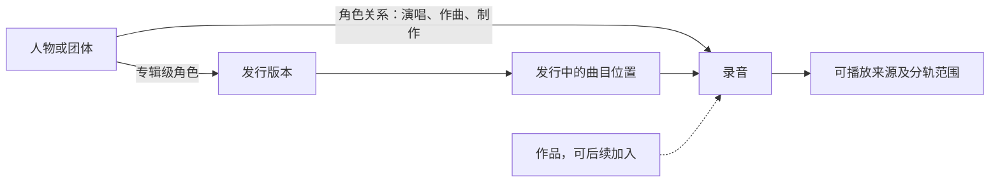

# Twilight Echo 与 Roon：Core 之外的差距和借鉴路线

评估日期：2026-10-22。依据当前工作区，包括正在实现的独立 Core；本次只新增分析文档，没有修改业务代码。

**结论：Twilight Echo 已经具备完整桌面播放器的主要基础。与 Roon 最值得追赶的距离，集中在音乐数据的组织、资料的可追溯性，以及这些数据驱动的浏览和发现体验。**

如果目标是个人电脑上的本地音乐、中文流媒体、歌词和调音，当前基础足以渐进改进。如果目标是 Roon 那样的人物／作品／版本资料网络与家庭多房间系统，仍有明显的产品与系统差距。后者还涉及数据覆盖、设备兼容和长期运行验证，不能用加几个页面来完成。

不建议给一个“完成了 Roon 的百分之几”：这里既有可以复用现成模块的工程任务，也有无法从客户端代码获得的云端数据和推荐能力。以下“小／中／大”只描述架构补齐范围，不代表音质、稳定性或实际用户体验评分。

**评估范围和证据边界**

读取了 Roon 分析的总览，以及搜索、音乐库、Browse、Radio、扩展、备份和音频信号路径的相关章节；抽查了反编译的 `TrackLiteData`、`ISwimSession`、`AlbumQueryCriteria` 和 `AlbumQueryInfo`。Twilight Echo 侧对照了实际模型、SQL、搜索、元数据、Rhine 扩展、动态队列、投放和 DSP 界面代码。

Roon 材料是特定版本的静态分析，不能证明其真实运行性能或所有产品行为；其总览已经修正早期报告中的 RAAT、Podcast、Nugs 等推断。本文优先采用修正后的专题和可见代码。Twilight Echo 的历史测试数字来自仓库记录，本次没有重新跑测试、试听或操作应用。独立 Core 的 staged 实现与生产接入仍分开看待，不把新目录存在等同于已经交付。

**当前差距分布**

| 方面 | 已核实的 Twilight Echo 基础 | 相比 Roon 的主要差距 | 补齐范围与建议 |
|---|---|---|---|
| 大曲库与队列 | 默认 SQLite、FTS5、分页、持久扫描、occurrence 身份、队列恢复 | 缺少同条件实测，不能断言容量或性能落后 | 基础已具备；继续复用，优先级不是换数据库 |
| 元数据治理 | 后台补全、匹配置信度、歌词来源、手动匹配 | 通用字段级来源、用户覆盖、来源切换和重算尚未统一 | 中到大；第一优先级 |
| 音乐实体关系 | 录音／发行版本关系、多来源、首选版本／音源、艺术家引用 | 主库缺少统一的人员角色、作品／演绎、发行实体网络 | 大；先做人员和发行，古典按需求扩展 |
| 搜索 | 跨源搜索、逻辑歌曲聚合、部分失败保留、拼音首字母、FTS5 trigram | 主路径偏来源优先和标题排序；角色、作品等检索维度不足 | 中；先改善召回和排序，不急于引入 Tantivy |
| 浏览与 Focus | 专辑／艺术家／流派、分页筛选、按完整查询播放 | 缺少完整的可组合条件、动态计数、保存查询及关系下钻 | 中；很适合成为下一项可见产品改进 |
| 推荐和 Radio | FM、雷达、心动模式、动态补队列、听歌统计 | 主要接平台推荐；缺少统一的本地／跨源候选与反馈体系 | 中到大；先做可解释的本地推荐 |
| DSP 的可解释性 | 效果链、实际输入输出信息、ACK、监测、等响度 A/B | 可进一步把完整实际处理过程呈现在日常播放入口 | 小到中；复用已有工作台，不必另造一套 |
| 插件和多端呈现 | Provider、主题、工具、全窗口体验、API 版本与宿主 | 插件产生的音乐资料未普遍进入主库；控制／显示协议可进一步收敛 | 中；重点是共享能力契约 |
| 备份 | 十类个人数据、冲突预览、路径映射、恢复日志、SQLite 恢复 | 还可补统一资产覆盖、计划任务、保留策略、增量快照 | 中；数据模型扩充时一起规划 |
| 多房间与设备生态 | LAN 遥控、DLNA／Chromecast、单远端输出 | 独立 Zone、多个 Endpoint、时钟漂移校正、设备适配生态 | 大；作为独立方向，不挤入本轮曲库改进 |

**1. 最值得先借鉴：元数据分层，而不是继续扩大一份 Track**

Roon 的关键设计是分别维护本地文件资料、外部识别资料和用户覆盖，再计算最终展示值。它允许逐字段偏好本地或外部来源，用户编辑最后生效；关系变化会触发相关派生记录重算。[R1]

Twilight Echo 不是没有防护：当前补全只填艺术家／专辑占位值、缺失流派、封面和歌词，并保留匹配来源、分数与置信度。[T1][T2] 但主要展示信息仍写回 `TrackData`，`metadataMatch` 是一次匹配的摘要，不能完整回答“这个字段从哪里来”“用户为何选这个值”“撤销覆盖后应该恢复哪个来源”。歌词的来源模型比其他普通字段更细，可以作为经验来源。

建议新增三类权威数据和一个可重建的读取视图：

- `SourceMetadata`：文件标签原值及各资料服务返回的原值，按来源分别保留。
- `MetadataAssertion`：字段或关系的值、来源记录 ID、取得时间、置信度／匹配依据、适用实体和版本。
- `UserOverride`：字段级 `inherit / set / clear`。不使用一个 `null` 同时表达“没有意见”和“明确清空”。
- `ResolvedMetadata`：按选择策略合成的展示值及选中来源，由 SQL 查询、搜索索引和界面共同使用。

这些名字是建议接口，不是现有实现。可以用 SQLite 普通表和关联表落地，不需要换成 LevelDB，也不需要为此引入图数据库。`TrackData` 可以继续作为兼容 DTO；新表保存资料事实，原有消费者逐步读取合成结果。

第一次交付只覆盖艺术家、专辑、流派、封面与介绍即可。验收应直接反映用户收益：用户改过标题后重扫不丢失；切换资料来源能恢复此前值；取消覆盖能回到当前来源值；修改一张专辑只刷新受影响的资料与索引。

**2. 把已有 Rhine 资料能力接入主曲库，比重新做资料插件更有价值**

这里有一个容易误判的现状：项目已经接入 `MusicBrainzProvider`、`QQCreditsProvider` 和专辑介绍服务，`MusicAlbum` 也包含制作人员、资料来源、release/release-group ID 和匹配状态。[T3]

但相关资料通过 `experienceDocument(pluginId)` 存在插件资料目录的 `music-metadata.json` 中；主库的 `TrackData` 与 `LibraryQuery` 没有相应的统一人物角色／作品关系查询。[T1][T3][T4] 因而当前缺的是从“某个扩展能显示资料”走到“整个播放器都理解这些资料”。这不是要求把所有插件内部缓存移入主库，而是把用户采纳的领域资料纳入统一模型。

建议先建立这条最小关系链：

需要分清“同一首作品”“同一次录音”“某张发行的第几首”“本地／在线的可播放来源”，也要继续保留你现有的队列 occurrence，后者不是录音 ID。不要因为标题、艺术家和时长相近，就永久把不同录音合并。

已有 `recordingIdentity`、`musicVersions` 和 source key 是迁移起点，不需要推翻。首先将明确的手工版本关系映射到稳定实体 ID；自动匹配作为待确认关系，保留依据和撤销入口。当前本地 source key 与路径及 CUE 段有关，移动文件会改变 key，应把音乐实体身份与文件当前位置进一步分离。[T5]

第一项有价值的功能可以非常具体：在专辑页点一个制作人，看到他参与的其他本地专辑，且角色清晰、来源可查看。第二项再做同专辑不同发行的版本页。只有古典曲库确有需求时，继续建设 Work／Performance／乐章层次，不必一次承接 Roon 的全部实体复杂度。[R1][R2]

**3. Focus 值得学，重点是统一查询语义**

Roon 的 `AlbumQueryCriteria` 有流派、厂牌、表演者、制作人员、作曲家、指挥、格式等 include/exclude 条件；`AlbumQueryInfo` 同时暴露对应分布和计数。[R3] 这让浏览从一组固定页面变成可反复缩小范围的收藏探索。

Twilight Echo 已有 `LibraryQuery`、SQL 分页、内容 revision 和完整查询播放，基础方向正确。目前过滤字段主要是无损、DSD、采样率、位深、目录、来源及几个专门字段，没有同等完整的组合条件模型。[T4]

建议在现有查询上增量增加有类型的条件树，例如 `all / any / not / predicate`，并让四个消费者共用它：列表、筛选计数、动态收藏、播放队列。条件树使用字段白名单与有界复杂度，执行仍由现有数据库服务承担；不要让每个 Vue 页面自己拼一份过滤逻辑。

第一版可以使用现有数据做：“本地无损 + 爵士 + 最近 90 天未听”，保存为动态收藏。人员／厂牌条件等第二阶段资料到位后加入。动态收藏保存条件及排序规则；点击播放时再由现有 revision／selection 机制冻结本次队列，避免播放途中队列随新扫描漂移。

要定义好分面计数：是在当前全部条件下计数，还是暂时排除本维度条件后计数。无论选哪种，列表、数字和播放结果必须一致。对于未知发行日期或从未听过的曲目，也需要明确条件语义。

Roon 的 browse:2 虽然按窗口返回条目，内部 UList 仍可能整表物化，item key 也有会话生命周期。[R2] 你的 SQL 分页没有必要退回这种实现；借鉴 criteria、结果视图和生命周期，保留现有的分页与稳定身份。

**4. 搜索先改质量，再决定引擎**

Roon 的价值在于分实体索引、字段权重、拼写处理、别名与关系召回，以及本地候选和云端服务的组合。Tantivy 只是实现选择之一；分析还明确指出某些统一搜索路径依赖云端完成最终组织。[R4]

Twilight Echo 已经使用 FTS5 trigram，并将拼音首字母加入检索文本；并非全库数组暴力搜索。[T6] 当前统一歌曲搜索把各来源当前页合并后，主要按音源／版本优先级及标题排序，逻辑聚合的范围也是这些候选页。[T7] 这与“按用户输入的相关程度排序”并非同一件事。

建议按顺序完善：

1. 将歌曲、专辑、人物分成不同检索文档；第一版仍可使用 FTS5。
2. 为精确标题、标题前缀、艺术家、专辑及别名定义明确的相关性规则。来源偏好主要用于同一录音的版本选择，不要无条件盖过相关性。
3. 保留中文、拼音首字母和文件名检索优势，补短查询策略和可选纠错。更换 tokenizer 前，用真实曲库样例验证。
4. 各来源先取有界候选，再融合、去重和分页；明确“当前页发现的版本”与“完整版本集合”的区别，后者由实体详情补全。
5. 本地先返回，较慢平台分批补入；断网保留本地结果和具体失败来源。每次更新继续沿用现有 generation/revision 防过期机制。

评价应包括相关性和可用性：常见精确曲名能否排在前列，同名异人是否正确，中文短词和首字母是否可用，慢音源是否拖住本地，以及 10 万／30 万曲目下的查询延迟与内存。只有这些证据指向 FTS5 的能力上限时，再考虑 Tantivy；同时养两套引擎目前收益不足。

**5. 推荐可借鉴“统一会话与候选管线”，不用先训练模型**

Roon 用 `ISwimSession` 统一云端 Radio、本地相似度和限定种子洗牌；本地实现组合人物、作品、流派等特征，配合历史去重和加权抽样。云端 Daily Picks 等算法不在这份客户端材料里。[R5]

你已经有 FM／雷达的 `PersonalizedQueue`、心动模式的 `HeartQueue`，也有取消、补队列、退避和未知写入结果处理。[T8] 应保留这些可靠性机制，在其前面加推荐来源与候选评价，而不是重写播放队列。

建议：`种子 → 候选提供者 → 可播放性与录音去重 → 相关性／新鲜度／多样性 → 队列补充`。候选提供者可以包括现有平台接口、本地相似音乐和指定范围洗牌。第一版用艺术家、流派、收藏、播放历史等现成特征；人员关系成熟后加入作曲／制作关系，BPM 等音频特征按覆盖率选用。

每次推荐保留简单原因，如“相同制作人”“收藏艺术家的其他作品”“很久没听”。用户跳过、不喜欢与播放完成是不同反馈；同一录音换来源不应绕过去重或屏蔽。服务不可用时明确回退到本地推荐，不将普通随机播放冒充个性化结果。

这一项的上限受资料覆盖率影响。先接通实体关系与来源，再做复杂推荐，会比直接复制 Roon 的权重常量有效。

**6. DSP、插件与多端：复用已完成的部分**

DSP 的信号概览已经读取源格式、实际设备／后端、实际采样率和节点状态，工作台也区分草稿、保存与实际 ACK。[T9] 因此不能把“做信号路径”作为一个从零开始的大项目。

可以借鉴 Roon 把处理环节与状态汇总为统一 SignalPath 的做法，[R6] 将现有能力扩大为日常播放栏可打开的只读说明：源格式、解码、实际启用的增益／响度／DSP／重采样、输出后端、设备格式，以及转换发生的原因。信息应来自已确认的实际状态；缺少设备内部观测时就显示未知。Direct 开关或相同采样率本身不足以证明 bit-perfect，也不应把 UI 徽章当作音质测量。

插件方面，现有 Provider、主题和完整工作区并不比 Roon API 的扩展目标狭窄；二者定位不同。Roon 值得参考的是官方 Display 自己也作为协议客户端消费播放和显示服务。[R7] 你可以让主界面、迷你播放器、遥控页和插件体验共享同一份可见能力与操作语义，同时保留各自界面布局。这与正在做的 Core 投影方向一致，不需要再另建一套状态 owner。

更具体的插件增量是 `MetadataProvider`：资料插件返回带来源的候选与关系，由统一资料服务合并；`RecommendationProvider` 返回候选与原因，由统一推荐服务选择。插件仍可保存自己的临时缓存，主库负责用户采纳的音乐事实。

保留 Vue 与现有组件。没有证据说明当前产品需要模仿 Broo 的渲染器、脚本 VM、自定义二进制 RPC 或手写 MVCC。

**7. 备份与多区：一个随资料模型完善，一个单独立项**

现有个人备份已经覆盖十类数据，有冲突预览、目录映射和 SQLite 恢复路径。[T10] 新增人物关系、用户覆盖和资料来源时，应一起加入可恢复范围。Rhine 资料现在单独保存，不能默认它已经包含在十类个人备份里；需要明确覆盖契约。

Roon 可借鉴的是备份 manifest、内容寻址去重、计划与保留、恢复前后的一致性边界。[R8] SQLite 项目应使用适合 SQLite 的一致快照和应用提交边界，不照搬 LevelDB 临时关库流程。先实现可校验和可恢复的快照，再视实际数据体积增加内容寻址增量；文件 SHA-256 是校验，不能替代恢复演练。

多区方面，当前 `CoreCastService` 明确为单远端输出，只有一个 target。[T11] Roon 的 Zone 聚合多个 Endpoint，并管理格式能力、时钟偏移、漂移、起播时间及分组兼容性。[R5] LAN 遥控、投放设备发现、同时给两台设备发送 Play，都不等价于这套同步能力。

如果产品确认要服务全屋音乐，建议分三步：多个独立播放区；兼容协议内的分组；可测量漂移的同步播放。届时需要真实多设备长时间测试与设备适配；现有 Core 独立化为此提供基础，但不自动解决它。现阶段不建议为了“像 Roon”抢先实现私有 RAAT 替代协议。

**建议的实施顺序**

| 顺序 | 建议交付 | 复用起点 | 用户能直接验证的结果 |
|---|---|---|---|
| 1 | 字段来源与用户覆盖最小模型 | 现有补全、手动匹配、歌词来源、SQLite | 重扫保留编辑；能查看／切换／撤销字段来源 |
| 2 | 接通 Rhine 人员和发行资料 | `experienceMusic`、`rhineMetadata`、版本关系 | 制作人可下钻；资料进入主库搜索和专辑页 |
| 3 | Focus 与保存查询 | `LibraryQuery`、分页、selection、SQL 队列 | 组合条件可保存；计数、列表和播放范围一致 |
| 4 | 搜索相关性与渐进结果 | FTS5、统一搜索、身份聚合 | 精确结果靠前；本地不受慢平台拖累 |
| 5 | 本地／跨源 Radio | FM／心动队列、统计、实体关系 | 离线可续播；能解释推荐；减少重复 |
| 并行小项 | 播放栏的信号路径说明 | `DspSignalOverview`、实际状态和监测 | 不进入调音编辑器也能看懂实际播放过程 |
| 随模型推进 | 完整资料备份与恢复 | 现有个人备份和 SQLite 恢复 | 换机后手工整理和资料关系可恢复 |
| 后续独立方向 | Zone／Endpoint 和同步播放 | 当前投放、设备档案、Core | 多房间独立播放，再验证分组同步 |

前四项的最终生产接入应跟随正在进行的 Core 单一 owner 切换。当前可以明确数据契约、来源适配和查询设计，不应另建一个与现有 Core 竞争的资料库或播放器服务。

**证据索引**

- [T1 主曲目与匹配模型](D:/Project/Twilight_Echo/src/shared/track.ts:11)：`TrackMetadataMatch`、`TrackArtistRef`、`TrackData`。
- [T2 补全的实际合并规则](D:/Project/Twilight_Echo/src/shared/musicMetadataMatching.ts:115)：保留本地值、补占位值、记录匹配摘要。
- [T3 Rhine 资料编排](D:/Project/Twilight_Echo/src/main/plugins/experienceMusic.ts:42)、[独立资料文档](D:/Project/Twilight_Echo/src/main/plugins/experienceDocuments.ts:13)、[资料结构](D:/Project/Twilight_Echo/src/shared/rhineMusic.ts:26)。
- [T4 查询契约](D:/Project/Twilight_Echo/src/shared/libraryDatabase.ts:37)：既有筛选、分页、版本约束和集合类型。
- [T5 录音身份规则](D:/Project/Twilight_Echo/src/shared/recordingIdentity.ts:41)、[来源 key](D:/Project/Twilight_Echo/src/shared/trackSourceIdentity.ts:22)、[版本关系说明](D:/Project/Twilight_Echo/docs/search-and-library-identity.md:65)。
- [T6 SQLite FTS5](D:/Project/Twilight_Echo/src/main/library/libraryDatabase.ts:334)、[搜索投影与拼音](D:/Project/Twilight_Echo/src/main/library/libraryDatabase.ts:990)。
- [T7 统一搜索合并](D:/Project/Twilight_Echo/src/shared/unifiedMusicSearch.ts:180)、[排序规则](D:/Project/Twilight_Echo/src/shared/musicSearchSources.ts:26)。
- [T8 FM／雷达队列](D:/Project/Twilight_Echo/src/core/playback/personalizedQueue.ts:31)、[心动队列](D:/Project/Twilight_Echo/src/core/playback/heartQueue.ts:35)。
- [T9 信号路径组件](D:/Project/Twilight_Echo/src/renderer/src/components/dsp-rack/DspSignalOverview.vue:56)、[DSP 工作台](D:/Project/Twilight_Echo/docs/dsp-workbench.md:7)。
- [T10 个人备份范围](D:/Project/Twilight_Echo/src/shared/personalBackup.ts:8)、[备份与恢复实现](D:/Project/Twilight_Echo/src/core/persistence/personalBackup.ts:93)。
- [T11 单远端输出](D:/Project/Twilight_Echo/src/core/cast/service.ts:30)。
- [T12 Core 当前实施状态](D:/Project/Twilight_Echo/docs/independent-core-progress.md:1)、[SQLite 交付记录](D:/Project/Twilight_Echo/docs/library-database-status.md:1)、[发布能力证据边界](D:/Project/Twilight_Echo/docs/release-capability-status.md:1)。
- [R0 总览与早期报告修正](D:/Project/res/roon-analysis/docs/00-总览与索引.md:1)。
- [R1 元数据三层与派生计算](D:/Project/res/roon-analysis/docs/05-音乐库与元数据实现.md:91)、[实体关系](D:/Project/res/roon-analysis/docs/05-音乐库与元数据实现.md:37)。
- [R2 Browse 和 Credits](D:/Project/res/roon-analysis/docs/11a-特色功能-Browse与内容元信息.md:20)。
- [R3 实际筛选契约](D:/Project/res/roon-analysis/decompiled/Roon.Broker.Api/Roon.Broker.Api/AlbumQueryCriteria.cs:8)、[分布与计数](D:/Project/res/roon-analysis/decompiled/Roon.Broker.Api/Roon.Broker.Api/AlbumQueryInfo.cs:10)。
- [R4 搜索架构](D:/Project/res/roon-analysis/docs/04-检索系统实现.md:7)、[字段权重](D:/Project/res/roon-analysis/docs/04-检索系统实现.md:260)。
- [R5 Radio 和多区](D:/Project/res/roon-analysis/docs/11b-特色功能-Radio推荐播客与多区.md:20)、[Radio 会话契约](D:/Project/res/roon-analysis/decompiled/Roon.Broker.Core/Roon.Broker.Music/ISwimSession.cs:8)。
- [R6 DSP 信号路径](D:/Project/res/roon-analysis/docs/03-DSP与音效处理实现.md:181)。
- [R7 API 与 Display](D:/Project/res/roon-analysis/docs/10-RoonApi与扩展生态.md:99)。
- [R8 备份与恢复](D:/Project/res/roon-analysis/docs/15-更新备份与运维.md:64)。
